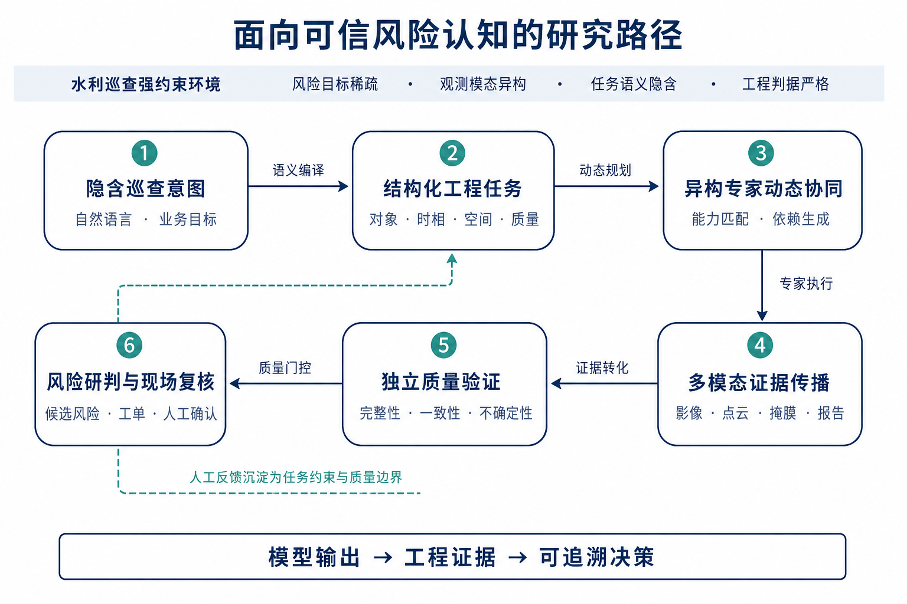

# HydroGuardian 水利遥感多模态专家智能体平台

> 第八届中国研究生人工智能创新大赛项目文档主稿  
> 当前版本：v1.2-md  
> 团队：水韵智巡者队

## 1 项目概况

### 1.1 背景和基础

#### （1）项目背景

水库大坝、堤防、岸坡和水闸长期受到水动力、地质环境、极端天气与人类活动共同作用，其风险常以弱小目标、局部渐变、跨时相异常或空间关系改变的形式萌生。水利巡查因而不能止于识别影像或点云中“有什么”，还需回答变化发生在哪里、涉及何种工程对象、是否满足风险判据以及证据能否支撑现场复核。由“发现异常”到“形成风险结论”之间的任务理解、专家协同和证据验证，正是传统单模型巡检难以覆盖的关键区间。

国家“人工智能+”行动与水利工程运行管理数字孪生建设为本项目提供了战略牵引。国务院提出推动人工智能与经济社会深度融合，发展人机协同的新型治理模式[1]；水利部、国家发展改革委要求以数智化手段提升风险查找、研判、预警、防范与处置能力，推动安全管理由事后处置向事前预防转型[2]。相关制度进一步强调“天空地水工”一体化感知、智能分析和风险闭环[3-4]。水利智能化的关键矛盾，正由“能否获取数据”转向“能否形成可信、连续且可行动的风险认知”。

多模态大模型正在突破传统遥感分类和图像问答的任务边界：GeoChat支持高分辨率遥感影像的区域级对话与定位[5]，GeoGround将水平框、旋转框和像素级掩膜纳入语言引导定位框架[6]，GPT4Point将语言理解延伸至三维点云[7]，ThinkGeo则开始评价真实遥感查询中的工具调用与多步规划能力[8]。地理空间智能由此进入“语言驱动、多模态感知、多工具协作”的新阶段。然而，水利巡查同时具有目标稀疏、模态异构、语义隐含和工程判据强约束等特征，仅将大模型作为工具选择器或顺序拼接多个模型，仍难以保证专家选择合理、跨步产物一致和风险结论可信。

水利多模态智能巡查由此面临三个相互耦合的基础问题。

第一，巡查任务以业务语言提出，其中隐含目标类别、空间邻域、时间对照和精度要求。现有方法缺少由开放表达向可执行工程语义迁移的统一机制，本质上是自然语言意图、观测条件、工程约束与专家能力之间缺少可计算的中间表示。

第二，影像、点云和几何关系具有不同的数据结构、空间尺度与误差来源。复杂任务需要多个专家按需协同，但现有研究多面向单模态或固定流程优化，尚未统一解决任务依赖动态生成、跨步骤空间基准保持及误差沿执行链传播等问题。

第三，模型置信度并不等同于工程可信度。算法产物只有满足输入完整、坐标一致、时相可比、关系合理和来源可追溯等条件，才能转化为风险证据。现有系统普遍缺少独立验证、异常反馈和不确定性传递机制，错误易在多步协作中累积放大。

> **本项目凝练的核心科学问题是：在风险目标稀疏、观测模态异构、任务语义隐含且工程判据强约束的水利巡查环境中，如何建立自然语言意图、多模态专家能力与工程风险证据之间的动态映射关系，并通过验证反馈抑制多步执行中的空间、时间和物理不一致，使 Agent 形成可校验、可溯源、可转化的风险认知？**

围绕上述问题，本项目提出“意图结构化—专家动态协同—证据独立验证—风险闭环转化”的研究思路：将巡查意图分解为对象、时相、空间关系和质量约束，建立任务语义与专家能力的可计算映射；以动态依赖图组织异构专家，使中间产物同时作为后续输入和可追溯证据；将独立验证嵌入执行过程，对完整性、一致性与不确定性进行门控，最终把可信算法产物转化为候选风险和复核依据，实现由“模型输出”向“工程证据”的跃迁。

**图1-1 面向可信风险认知的研究路径**

#### （2）项目基础

团队在上一届“河图智眸——采砂监管智能体协执系统”中，已完成水域二维影像与三维点云的数据采集、标注和组织，形成目标检测、点云语义分割、空间测量、异常报告及Web业务闭环等经验。前期工作验证了多源观测用于水利监管的可行性，也揭示出固定任务链、单场景绑定和缺少独立质量门控等局限，为本项目由单场景模块协执升级为开放任务多模态专家Agent提供了直接基础。

项目已形成支撑意图结构化研究的数据与任务基础。WCS 10M水利遥感数据包含1,636个固定划分Tile，覆盖15类水利场景要素；在此基础上构建22,232条标准任务动作和22,232条分层查询样本，覆盖直接回答、单工具调用、多步工作流、类别定位、属性约束、空间关系及空目标情形，为研究隐含业务意图向结构化任务的迁移提供了可控样本。

项目已构建五类边界明确的真实专家：RFANet负责双时相变化检测，GUFNet负责点云语义分割，HydroProgram3D执行语言引导的三维定位，Geometry专家计算距离、高差和邻近关系，Verifier专家独立检查结果质量。各专家以统一能力契约描述输入、输出和适用边界，使专家选择与任务依赖能够被显式计算。

项目已建立面向证据传播的运行基础。任务、步骤、事件和专家产物具有独立标识与状态记录，执行器依据任务依赖形成动态工作流，并支持进度反馈、异常恢复、取消与重试。依托与相关企业的合作，项目已获得真实水利场景数据，包括2018年与2023年两期影像、对应三维点云及快速联调数据。五类专家已完成真实调用和产物传递验证，能够生成变化区域、语义标签、目标掩膜、几何关系和质量报告，为任务编译、专家路由和证据一致性实验提供现实条件。

在业务验证层面，Web端已贯通任务发起、动态执行、证据研判和工单生成，Android APP覆盖现场定位、移动取证、处置反馈与人工复核。人的确认、修正或驳回能够反向沉淀为任务约束和质量边界，使项目具备从算法执行到现场验证的闭环基础。

综上，项目已具备数据、专家、执行与业务闭环基础，能够支撑隐含意图结构化、异构专家协同和验证反馈驱动的可信证据生成研究。

### 1.2 场景和价值

#### （1）应用场景

HydroGuardian面向水库大坝、堤防岸线、库岸边坡和水闸等区域的常态巡查与专项排查。此类任务往往具有巡查范围大、风险目标稀疏、数据模态多样和业务问题临时变化等特征，难以由单一模型或固定流程覆盖。管理人员可使用自然语言提出任务并提交双时相影像、三维点云等数据，系统自动解析巡查对象、时相、空间关系和质量要求，动态组织相应专家完成协同研判。

**场景一：大范围风险初筛。** 面对库区、河道和堤防沿线覆盖范围大、人工逐点核查效率低的问题，系统利用双时相影像发现新增、消失及显著变化区域，并结合地物类别、空间位置和邻近关系生成候选风险。其作用是将海量观测压缩为少量重点核查对象，使巡查由无差别筛查转向风险驱动。

**场景二：重点目标精细核查。** 针对“岸坡附近是否出现新增目标”“异常区域是否邻近水工设施”等问题，系统联合影像纹理与时相信息、点云几何与高程信息以及自然语言中的关系约束，识别目标类别、位置和形态，计算距离、高差与邻近关系。研判结果不再停留于疑似目标标注，而是形成可定位、可量测、可追溯的多模态证据。

**场景三：突发与专项任务响应。** 强降雨、库水位变化、地质扰动或临时执法检查产生的任务通常难以预先穷举。系统可依据当前问题、可用数据和专家能力实时生成执行流程；当输入缺失、结果冲突或质量检查未通过时，主动说明不确定性和待补充证据，并转入人工复核，避免在证据不足时输出过度确定的结论。

上述场景最终贯通“智能研判—工单派发—现场取证—人工复核—反馈沉淀”闭环。Web端负责任务发起、协作监控、证据研判和工单生成，移动端支持现场定位、取证与处置反馈；人工确认、修正或驳回结果进一步沉淀为任务约束和质量边界，使数字分析能够持续转化为现场行动。

#### （2）核心价值

**科学价值：** 项目探索开放工程任务中“意图—能力—证据”的统一表征机制，将自然语言意图、观测模态、专家能力和工程判据纳入同一动态过程，研究隐含意图如何转化为可执行任务、多源结果如何形成一致证据以及验证反馈如何抑制长链推理中的误差传播，推动多模态智能由数据融合走向认知协同。

**方法价值：** 模型的高置信输出并不天然等同于可靠的工程证据。项目通过独立质量验证检查输入完整性、结果一致性、掩膜有效性与关键产物，并保留任务、步骤和证据之间的来源关系，建立模型置信度向工程可信度的转换路径，使算法产物可验证、风险结论可解释、异常状态可干预。

**工程价值：** 项目以统一能力契约封装变化检测、语义分割、语言引导定位、几何分析和质量验证等专家，根据任务动态生成执行图，突破传统系统中模型、接口与业务流程紧耦合的限制。新专家能够按照输入输出和适用边界接入，实现模型、数据和算力资源的组合复用与持续扩展。

**业务与社会价值：** 项目将遥感观测转化为带有空间位置、证据来源和复核条件的风险线索，使管理人员能够快速派发任务，现场人员能够针对性核查，复核人员能够追溯结论依据。相关机制还可迁移至河湖“四乱”排查、岸线变化监测、工程设施巡检和灾后核查等任务，提升有限巡查力量的配置效率，支撑水利安全治理由被动响应向主动预防转型。

综上，HydroGuardian形成“自然语言需求—专家协同—质量验证—工程证据—现场复核”的完整路径，统一回答复杂任务如何执行、智能结果何以可信以及风险结论如何转化为行动三个关键问题，为多模态Agent进入水利等强约束工程场景提供可复用的方法和系统基础。

### 1.3 所需支持

项目已完成五类专家、动态执行框架、Web研判端与移动复核端的原型构建，当前所需支持主要面向系统规模化验证、国产算力适配和真实业务落地，而非基础功能开发。

#### （1）算力与工程适配支持

现有变化检测、点云语义分割和语言引导定位专家对GPU显存、数据吞吐及模型并发具有较高要求。项目需要稳定的训练与推理算力，以及对象存储、任务调度和运行监控等云端资源，用于开展多专家并发、长时任务、异常恢复和跨节点调度测试。同时希望获得国产AI计算平台的迁移指导，完成核心模型的算子适配、推理加速和精度一致性验证，形成可在国产软硬件环境部署的专家运行方案。

#### （2）数据与行业知识支持

依托与相关企业的合作，项目已获得双时相影像、三维点云等真实水利场景数据，并结合WCS 10M数据完成原型验证。下一阶段需要在现有合作基础上扩大区域、季节、传感器和工程类型覆盖，完善困难样本、风险事件和现场复核结果的持续标注；同时引入风险判据、巡查规范和典型案例等行业知识，用于验证跨区域迁移能力，并完善风险等级、质量边界与人工复核规则。

#### （3）真实场景与专家评测支持

项目将在现有企业合作与真实数据基础上进一步开展联合场景验证，围绕常态巡查、专项排查和灾后核查选取代表性任务，由业务人员提出自然语言需求，系统完成分析并生成风险证据，再由专业人员进行现场复核。通过对任务理解准确性、专家路由合理性、证据完整性和风险结论有效性的联合评价，检验系统在真实数据波动、目标稀疏和证据不足条件下的可靠边界。

#### （4）成果转化与生态支持

项目希望获得系统安全、数据合规、行业标准和产品化方面的指导，进一步完善权限控制、数据隔离、审计追踪和模型版本管理机制；同时对接人工智能、水利信息化和遥感应用生态伙伴，推动五类专家能力以标准接口持续扩展，形成可复制的部署方案与典型应用案例。

上述支持将帮助项目完成由“可运行原型”向“可验证、可迁移、可部署系统”的跃迁，进一步验证多模态专家Agent在水利强约束场景中的技术价值和应用潜力。

## 2 项目规划

### 2.1 整体目标

本项目面向水利巡查中任务语义隐含、观测模态异构、专家能力分散和工程证据不足等问题，建设具备自然语言理解、动态专家协同、独立质量验证和人机闭环能力的水利遥感多模态专家Agent。项目以“可信风险认知”为主线，不追求由单一模型直接给出工程结论，而是建立巡查意图、专家能力、算法产物与风险证据之间的可计算关系，使系统能够根据不同任务自主形成执行路径，并在明确质量边界后将分析结果转化为可定位、可核查、可追溯的候选风险。

#### （1）形成面向开放巡查需求的任务结构化能力

研究自然语言业务表达向工程任务语义的转换方法，将巡查对象、属性、时相、空间关系、输入模态和质量要求编译为结构化AgentRequest，并以其中的AgentAction区分直接回答、单专家调用、多专家协同、信息澄清和谨慎拒答等任务形态。系统依据ToolSpec完成参数和输入约束校验，降低自然语言理解与实际执行之间的语义偏差。

#### （2）形成五类异构专家的动态协同能力

建立统一的专家能力描述、注册和调度机制，将RFANet变化检测、GUFNet点云语义分割、HydroProgram3D语言引导定位、Geometry几何分析和Verifier质量验证组织为可按需组合的能力集合。Agent依据任务目标、数据条件、步骤依赖和运行资源动态生成单工具调用或多专家执行图，使专家协作不再受固定场景和预设步骤限制，并支持执行状态追踪、异常阻断、取消与重试。

#### （3）形成面向工程风险的可信证据体系

以可追溯Artifact贯穿原始数据、专家产物、质量报告和风险区域，建立输入来源、处理步骤与结论依据之间的关联。通过独立Verifier检查数据完整性、标签与点数一致性、概率范围、掩膜有效性、空目标及关键产物，对证据不足或结果异常的任务给出警告、谨慎停止或人工复核建议，推动算法结果由“可输出”提升为“可验证、可解释、可追责”。

#### （4）形成数字研判与现场处置的人机协同闭环

贯通Web端任务发起、动态执行、证据研判和工单生成，以及Android APP端现场定位、移动取证、处置反馈与人工复核。系统将通过质量验证的算法产物编译为候选风险和核查重点，保留工程人员的最终判断权，并将确认、修正或驳回结果沉淀为后续任务约束和质量边界，实现“智能发现—证据验证—现场核查—反馈学习”的持续闭环。

通过上述目标，项目最终形成一个核心Agent统一规划、五类专家按需协同、质量验证独立门控、Web与移动端共同承接的水利智能巡查体系，为复杂工程环境下多模态Agent的可信执行与规模化应用提供可复用的方法和系统基础。

### 2.2 技术创新点

本项目的创新不在于简单增加模型数量，而在于围绕水利巡查“任务如何形成、专家如何协作、结果何以可信、证据如何进入决策”建立完整技术链，使智能巡查由孤立模型调用升级为可规划、可验证、可闭环的可信Agent系统。

#### （1）工程语义约束驱动的巡查任务自主规划

现有智能巡查多将自然语言映射为预设指令或固定流程，难以表达对象属性、时相对照、空间关系、输入条件和质量要求。本项目构建面向水利巡查的结构化AgentRequest，以AgentAction表达决策类型，并以ToolSpec约束专家名称、参数、输入模态和输出类型，使任务能够根据语义与数据条件形成直接回答、单专家调用、多专家Workflow、信息澄清或谨慎拒答等不同执行形态。

该机制的关键不是让大模型生成一段操作文本，而是建立自然语言意图到工程执行约束的中间表示。项目以22,232条标准任务动作和L0—L3分层查询为数据基础，覆盖类别、属性、空间关系、空目标及多步任务，为任务编译与规划一致性提供可训练、可评价的载体，从源头降低“语言上理解、执行中失真”的风险。

#### （2）能力—依赖—资源联合约束的异构专家协同

传统系统通常将模型调用顺序写入业务代码，任务或数据变化后需要重新编排。本项目以统一能力契约封装RFANet、GUFNet、HydroProgram3D、Geometry和Verifier五类专家，显式描述其输入、输出、参数、适用边界和资源需求；核心Agent综合任务目标、可用模态、步骤依赖和Worker运行状态，动态生成单工具调用或多专家有向无环图，使专家组合与步骤数量随任务变化，而非固定为某种智能体结构或执行阶段。

在工程实现上，控制面负责任务规划、状态管理和依赖解析，远程Worker负责加载真实模型或确定性算法，大文件通过对象存储传递，控制消息与产物引用独立流转。该设计既支持GPU与CPU专家协同，也支持能力发现、进度追踪、取消、重试和异常恢复，使“专家按需组合”由概念规划转化为可运行、可扩展的分布式执行机制。

#### （3）独立质量门控与不确定性传递

模型置信度通常只反映单次预测分布，不能直接代表工程结论可信。本项目设置独立于任务专家的Verifier，不重新预测类别，而是检查执行来源、输入完整性、标签空间、点数一致性、概率有效性、掩膜对齐、空目标和关键产物完备性，并将质量结论作为后续风险转化的前置条件。

验证结果不只给出通过或失败，还能够携带警告、缺失证据和人工复核建议；当关键条件不满足时，系统可谨慎停止而非强行输出确定性结论。由此，质量控制由推理结束后的附加展示转变为嵌入执行链的独立门控，不确定性能够沿步骤和证据继续传递，从而抑制单个专家误差在长链协作中的累积放大。

#### （4）Artifact谱系驱动的风险证据与闭环决策

现有算法结果通常以掩膜、标签或报告分散保存，仍需人工判断其来源和业务意义。本项目以Artifact为证据载体，将原始影像与点云、变化区域、语义标签、目标掩膜、几何报告、质量报告及执行事件组织为可引用的产物谱系，保留“使用何种输入、由哪个专家生成、经过何种验证、支撑哪个空间区域”的完整关系。多模态协同因此不依赖宣称单一模型完成统一融合，而通过跨专家产物的关联形成面向工程研判的证据协同。

通过质量门控的Artifact可进一步组织为EvidencePack、候选RiskCard、处置建议和WorkOrder，Web端承接数字研判，Android APP承接现场定位、移动取证和处置反馈，人工确认、修正或驳回结果继续沉淀为任务约束和质量边界。该机制把“发现目标”扩展为“说明为何可信、优先核查哪里以及下一步如何处置”，实现算法产物向工程证据、风险事项和现场行动的连续转化。

四项创新构成由任务认知到业务决策的递进关系：自主规划解决“做什么”，专家协同解决“由谁、如何执行”，可信验证解决“结果能否使用”，闭环决策解决“证据如何转化为行动”。它们共同支撑HydroGuardian从模型能力集合演进为面向强约束工程场景的可信Agent系统。

## 3 实施方案

### 3.1 技术可行性分析

本项目并非停留在概念设计阶段，已形成由数据与任务样本、真实专家模型、分布式执行系统和跨端业务闭环共同支撑的实现基础。现有条件能够覆盖“任务理解—专家执行—质量验证—风险研判—现场复核”的主要环节，为后续规模化测试和工程部署提供可验证的技术起点。

#### （1）数据与任务基础可行

项目采用WCS 10M水利遥感数据，按照固定划分形成训练集1,145个Tile、验证集246个Tile和测试集245个Tile，共1,636个Tile，覆盖15类水利场景要素。在此基础上构建22,232条标准任务动作及对应分层查询，包含直接回答、单工具调用和多步Workflow，覆盖类别、属性、空间关系、空目标以及L0—L3不同表达难度，可用于训练和评价自然语言意图向结构化任务的迁移能力。

依托与相关企业的合作，项目已获得2018年与2023年两期真实影像及对应三维点云，并制作快速联调数据。公开数据提供统一标签空间和可重复划分，企业数据提供真实环境中的跨时相变化、目标稀疏和数据尺度差异，两者互补，能够支持模型训练、任务规划评测与真实案例验证。

#### （2）专家算法基础可行

项目已完成五类专家能力的真实接入：RFANet负责双时相变化检测，输出变化掩膜、概率图和变化区域；GUFNet负责点云语义分割，输出点级标签、类别掩膜和概率；HydroProgram3D根据自然语言定位三维目标；Geometry专家通过确定性算法计算距离、高差、邻近关系和类别统计；Verifier独立检查专家结果的完整性与一致性。学习型模型与确定性算法分工明确，可分别承担感知、定位、量测和验证任务。

五类专家均已完成真实在线调用和产物传递验证，能够生成变化区域、语义标签、目标掩膜、关系掩膜、几何报告和质量报告。系统不依赖单一模型覆盖全部模态，而是以统一能力契约约束输入、输出和适用边界，使不同专家可以被独立测试、替换和扩展，降低单个模型变化对整体流程的影响。

#### （3）Agent与分布式系统可行

项目已实现AgentRequest、AgentAction、ToolSpec和Workflow Executor等核心机制，能够校验任务参数、解析步骤依赖并执行单工具调用或多专家DAG。控制面已部署任务、步骤、事件和产物管理服务，远程Worker通过能力注册与心跳机制接收任务；PostgreSQL、Redis、RabbitMQ和MinIO分别承担持久化、状态支撑、异步调度和大文件存储，控制消息与影像、点云等大文件分离传输。

当前四个远程Worker在线，五类专家已完成联调；系统具备进度反馈、取消、重试、异常阻断和产物下载能力，现有自动化测试记录为146项通过、4项跳过。任务全过程保留Job、Step、Event和Artifact标识，使专家选择、状态迁移、产物来源和质量结论均可追踪，为系统调试、失败恢复及实验复现提供工程基础。

#### （4）业务闭环基础可行

Web端已覆盖自然语言任务发起、资产上传、动态执行监控、专家证据展示、候选风险研判和工单生成；Android APP已覆盖工单接收、现场定位、拍照取证、情况说明、失败重试和人工复核。数字研判结果能够携带位置、来源产物、质量结论和核查重点进入现场流程，现场反馈则通过确认、修正或驳回形成闭环记录。

该跨端体系保留人工最终判断权，符合水利工程风险结论需要专业复核的业务要求。系统既可展示算法能力，也能够验证数字证据能否被现场理解、核查和修正，为评价Agent的工程有效性提供了完整载体。

#### （5）实施与持续扩展可行

团队已在上一届项目中积累影像与点云处理、模型训练、空间量测、Web业务系统和移动端开发经验，本项目进一步完成新Agent控制面、远程专家和质量验证机制建设。现有企业合作提供真实数据与应用需求，远程GPU和CPU资源能够支撑模型运行，统一接口与对象存储机制则使新增专家和新场景能够在不重构核心流程的条件下逐步接入。

#### （6）主要风险及控制措施

- **模型误判与空目标风险：** 通过独立Verifier检查概率、掩膜、点数、空目标和关键产物，异常结果不直接进入风险结论，并保留人工复核。
- **影像与点云空间不一致风险：** 在任务输入和专家产物中保留坐标、时相与来源信息，对配准条件和空间关系进行显式校验。
- **专家掉线与长时任务中断风险：** 通过Worker心跳、状态持久化、依赖阻断、取消和重试机制降低单节点异常对整体任务的影响。
- **网络与大文件传输风险：** 大文件通过对象存储和预签名地址传输，系统持久化稳定Artifact ID，避免将临时下载地址作为长期证据引用。
- **数据安全与结论责任风险：** 对企业数据实施授权、脱敏和访问控制，保留操作及产物审计记录，并将系统输出限定为候选风险和待复核结论。

综上，项目已具备可训练的数据体系、可调用的真实专家、可追踪的执行平台和可落地的业务闭环，主要技术风险均有对应控制机制，整体实施路径明确且具备持续扩展条件。

### 3.2 技术细节

#### 3.2.1 总体技术架构与运行链路

HydroGuardian采用“核心Agent统一规划、异构专家分布执行、证据产物集中管理、质量验证独立门控、管理与现场协同闭环”的总体架构。系统并非将多个模型顺序拼接，而是以巡查任务为牵引，将自然语言、遥感影像、三维点云和工程规则组织为结构化输入，再根据任务语义、数据条件和专家能力动态形成执行路径。整体由任务与数据层、Agent控制层、专家执行层、证据与基础设施层、业务应用层五部分组成。

**任务与数据层**负责接收自然语言巡查需求、单期或双时相正射影像、三维点云以及水域范围、工程区域、高程阈值等业务约束。系统在任务进入执行前识别巡查对象、时相关系、空间条件、所需模态和质量要求，避免将不完整或不匹配的数据直接交给模型处理。

**Agent控制层**承担任务理解与执行决策。Planner将巡查意图编译为结构化AgentRequest，并通过其中的AgentAction、Arguments和Workflow表达动作、参数与步骤依赖；ToolSpec进一步校验专家能力、输入模态、参数范围和输出类型，Workflow Executor据此生成单工具调用或多专家有向无环图，并由调度模块结合Worker在线状态和资源条件下发任务。Job、Step和Event持续记录任务及步骤状态，使动态工作流具备可观察、可取消、可重试和可恢复的执行基础。

**专家执行层**由五类能力边界明确的专家组成：RFANet完成双时相变化检测，GUFNet完成点云语义分割，HydroProgram3D执行语言引导的三维目标定位，Geometry计算距离、高差与邻近关系，Verifier独立检查结果质量。专家部署于GPU或CPU Worker中，可根据不同任务形成不同组合和执行顺序，不受固定阶段限制。

**证据与基础设施层**统一管理原始资产、中间产物和运行状态。影像、点云、变化掩膜、概率图、目标掩膜及分析报告以Artifact形式存入对象存储，数据库保留其来源任务、生成步骤和质量状态；Redis与RabbitMQ分别支撑状态缓存和异步调度。控制链仅传递任务参数、状态与Artifact引用，大文件通过对象存储独立传输，从而降低长时模型执行和跨节点传输对控制面的影响。

**业务应用层**将通过验证的专家产物进一步组织为EvidencePack、候选RiskCard、RecommendationCard和WorkOrder。Web端承担任务发起、执行监控、证据研判与工单派发，Android APP承担现场定位、拍照取证、处置反馈和人工复核。未通过质量验证的结果不进入风险转化，现场确认、修正或驳回则继续沉淀为任务约束和质量边界。

由此，系统形成“任务输入—自主规划—专家执行—证据汇聚—质量门控—风险研判—现场复核”的完整运行链路。该架构将Agent控制、真实模型执行、证据管理与业务处置相互解耦，又通过稳定的任务标识和Artifact谱系保持全过程关联，为后续专家扩展、异常恢复和风险结论追溯提供统一基础。

#### 3.2.2 多层数据集构建

为同时支撑场景感知、变化识别、语言引导定位和Agent自主规划，本项目构建由点云语义数据、双时相变化检测数据、语言引导任务数据和Agent任务数据组成的四层数据体系。四类数据由底层观测逐级派生到高层任务监督，并通过固定场景划分保持训练、验证和测试边界，使模型能力、语言理解与专家路由能够在统一水利场景语义下衔接。

**（1）WCS3D点云语义数据。** 团队面向大坝、堤防、岸坡、水闸和库岸等典型水利工程开展无人机影像与三维点云采集，经坐标统一、噪声清理、场景切分和点级标注，形成约2.65亿点的WCS3D水利点云数据。标签体系按照工程语义组织为5个大类、15个小类，覆盖水体、植被、道路、坝体结构、坡面及其他场景要素。为适配模型训练和Agent数据生成，数据进一步整理为1,636个固定Tile，其中训练集1,145个、验证集246个、测试集245个；每个Tile关联点云、点级标签和可用影像，划分后不再跨集合复用，从源头降低相邻场景造成的信息泄漏。

**（2）DTX-CD双时相变化检测数据。** 团队基于大藤峡区域不同阶段的高分辨率无人机影像构建流域变化检测数据，包含约4,000张影像，覆盖林地、草地、建筑物、道路、裸地和水域等典型地物变化。数据构建过程首先对不同时相影像进行几何校正、同区域匹配和尺度统一，再依据真实变化范围制作像素级标签，并按场景与时相组织前后期影像对。该数据用于训练和评价RFANet对新增、消失及显著变化区域的提取能力；企业合作获得的2018年和2023年真实影像则作为独立案例数据，用于检验模型在跨年份、超大幅面场景中的迁移与工程应用能力。

**（3）语言引导三维任务数据。** 在点级语义标签基础上，项目进一步生成面向HydroProgram3D的自然语言—点云—目标掩膜样本。任务覆盖类别定位、属性约束、空间关系和空目标四类条件：类别任务由语义标签直接确定目标点集，属性任务叠加形态或尺度条件，关系任务利用距离、高差和邻近关系生成组合掩膜，空目标任务则保留无匹配点的真实监督。每条样本同时记录自然语言查询、场景资产、目标掩膜和空间约束，并设置由明确指令到隐含巡查需求的不同表达层次，使模型学习从语言语义恢复目标及关系，而非记忆固定模板。

**（4）VagueHydro Agent任务数据。** 项目以冻结的Tile划分和影像—点云—语言标注为基础，先通过确定性规则生成标准任务动作，再进行分层自然语言改写。构建程序将源任务规范化为直接回答、单工具调用和多步Workflow，逐条检查资产是否存在，并依据部署使用的ToolSpec验证工具名称、参数、输入模态、输出类型和步骤引用。最终形成22,232条标准任务动作，其中直接回答10,298条、单工具调用10,271条、多步Workflow 1,663条；对应查询划分为训练集14,295条、验证集3,886条和测试集4,051条，并包含3,346条空目标样本。

为提高语言表达的真实性，Agent任务在生成阶段设置L0—L3四个层次：L0显式给出目标和输出，L1使用自然改写与类别别名，L2隐藏算法名称但保留任务粒度，L3以现场巡查、工程复核或风险筛查目标间接表达需求。生成过程中移除资产路径和工具名称提示，采用分集合提示模板、语义签名校验与去重策略，并通过审计报告检查动作分布、资产完整性和跨集合泄漏。由此形成从点级场景标注、双时相变化监督、语言目标掩膜到Agent工作流标准答案的多层数据基础，为五类专家训练、自然语言理解和动态规划评价提供统一支撑。

#### 3.2.3 核心Agent的任务动作学习与动态规划

水利巡查语言往往将对象、属性、时相、空间关系、排除条件和质量要求隐含在开放式业务表达中。若仅依赖提示词临时选择工具，模型容易出现任务理解正确但专家选择、参数组织或步骤依赖错误的问题。为此，HydroGuardian不将核心Agent定位为通用问答入口，而是以结构化任务动作学习为基础，使其形成“理解任务—评估能力—选择专家—组织流程”的能力感知决策机制，并据此将自然语言需求转化为可校验、可执行的动态Workflow。

**任务动作监督构建。** 项目以3.2.2节构建的VagueHydro任务数据为监督基础，将自然语言查询、可用影像及资产清单与标准任务决策配对。每条标准答案统一表示为结构化AgentRequest，其中AgentAction描述直接回答、专家调用、信息澄清或谨慎拒答等决策，Arguments记录目标、模态、时相与空间约束，Workflow则描述多专家任务的步骤及Artifact依赖。训练样本覆盖由明确指令到隐含巡查意图的L0—L3表达层次，使模型学习的不是固定关键词到工具名称的映射，而是任务条件、专家能力与预期产物之间的对应关系。

**核心Agent任务适配。** 项目以Qwen3-VL-8B-Instruct为基础模型，采用LoRA监督微调注入水利巡查任务动作知识，重点学习任务理解、能力选择和依赖规划三项能力。训练过程仅优化核心Agent对结构化决策的生成能力，GUFNet、RFANet、HydroProgram3D及确定性专家保持独立训练和部署，从而避免不同模态模型的训练目标相互耦合。在线推理时，Agent接收自然语言、视觉上下文与资产元数据，影像、点云等大体量原始数据则依据Workflow直接进入相应专家，避免将百万点级点云压入大模型上下文。核心Agent的任务动作学习与能力感知推理过程如图3-3所示。

**图3-3 HydroGuardian核心Agent的任务动作学习与能力感知推理框架**

**能力边界与动作生成。** 在线推理遵循“Understand—Select—Plan”的决策链。Planner从Query与Assets中提取任务类型、目标对象、属性、时相、空间关系、输入模态和预期产物，并写入AgentRequest；其中AgentAction给出决策类型，Arguments和Workflow进一步约束执行内容。核心Agent首先判断任务能否在内部可靠解决：简单知识任务直接回答，必要信息不足时请求澄清，能力或可靠条件不成立时谨慎拒答；需要专业计算时，再生成单专家调用或多专家Workflow。由此，Agent不仅决定任务如何执行，也明确何时不应继续自动执行。具体动作类型、触发条件与系统行为见表3-1。

**表3-1 核心Agent动作类型及其决策机制**

| 动作类型 | 触发条件 | 系统行为 |
|---|---|---|
| 直接回答 | 不需要调用外部专家 | 返回结构化说明及依据 |
| 单工具调用 | 单一能力可产生目标产物 | 生成一个专家步骤 |
| 多专家Workflow | 目标产物依赖多个中间结果 | 生成带依赖关系的DAG |
| 信息澄清 | 缺少必要数据或约束 | 明确提示需补充的内容 |
| 谨慎拒答 | 能力不匹配或可靠条件不成立 | 保留原因并终止执行 |

**基于ToolSpec的能力匹配。** 外部专家通过ToolSpec声明任务能力、输入模态、参数范围、输出Artifact、资源要求和验证条件。AgentAction描述任务需求，ToolSpec描述专家供给，规划器据此完成匹配。例如，变化检测必须具备前后期影像，几何分析必须获得点云及前序分割结果；输入或参数不满足契约时，任务在模型执行前即被阻断。

**动态Workflow生成。** 规划器从预期输出反向查找可生成该产物的专家，再沿输入要求补充前序步骤，形成有向无环图。节点对应专家调用，边表示Artifact依赖。工作流生成后检查资产、参数、输入输出类型、空间基准和循环引用，并按ToolSpec要求追加Verifier。不同任务由此形成不同步骤和组合，而非套用固定流程。

**能力感知的Worker调度。** Workflow Executor将步骤提交至Worker Hub，调度器依据Worker上报的工具能力、在线状态及CPU/GPU资源选择执行端，通过WebSocket下发参数和Artifact引用；大文件由Worker从对象存储获取。Job、Step和Event记录任务、步骤及过程状态，前端通过SSE接收实时进度。

**异常阻断与恢复。** 当前序失败、专家不可用或Worker心跳中断时，执行器停止依赖步骤并保留原因，不使用不完整产物继续推理。任务支持取消与上下文保留重试；专家暂不可用时进入谨慎阻断，待能力恢复后重新调度。

代表性组合包括“RFANet—Verifier”双时相变化分析、“HydroProgram3D—Verifier”语言引导定位，以及“GUFNet—Geometry—Verifier”综合点云分析。简单知识任务可直接回答，输入不足任务进入澄清分支；实际步骤仍由任务、资产和专家状态共同决定。

系统采用统一AgentRequest与ToolSpec契约，同时支持Planner自动生成和显式提交`planned_request`。前者用于自主规划训练与评价，后者可固定真实联调条件、保证案例复现；两者均进入同一Workflow Executor，共享调度、状态记录和质量验证机制，从而兼顾自主性与工程可复现性。

#### 3.2.4 五类异构专家的协同感知与可信验证

水利巡查同时涉及全场景认知、时序变化发现、语言目标定位、空间关系量测与结果质量控制，单一模型难以覆盖不同模态和推理层次。为此，项目团队面向水利场景自主设计并训练GUFNet、RFANet和HydroProgram3D三类学习型专家，并构建几何关系与结果验证两类确定性专家。五类专家以统一ToolSpec声明输入、输出和可靠条件，通过Artifact传递中间产物，在核心Agent规划下形成“感知—推理—验证”的按需协作体系。其能力分工见表3-2。

**表3-2 HydroGuardian五类异构专家的能力分工**

| 专家 | 主要输入 | 核心能力 | 主要产物 | 业务作用 |
|---|---|---|---|---|
| GUFNet | 三维点云 | 水利场景点云语义分割 | 点标签、类别掩膜、类别概率 | 构建全场景语义底图 |
| RFANet | 双时相影像 | 轻量化遥感变化检测 | 变化掩膜、概率图、区域报告 | 发现新增、消失及形态变化 |
| HydroProgram3D | 自然语言、点云及几何证据 | 多条件语言引导目标分割 | 目标掩膜、目标概率、结构化推理轨迹 | 定位任务指令描述的目标 |
| 几何关系专家 | 点云与分割结果 | 距离、高差及区域统计 | 关系掩膜、几何报告 | 形成可量化空间证据 |
| 结果验证专家 | 专家产物及原始资产 | 完整性、一致性与可信度检查 | 质量报告、诊断结果 | 控制结果进入自动决策的条件 |

**GUFNet点云语义分割专家。** 针对无人机水利场景中几何—纹理混淆、影像与点云异质退化以及沟渠、道路、堤坝等细长结构易断裂问题，GUFNet采用非对称教师—学生架构：训练阶段利用影像—点云协同学习，部署阶段仅保留点云分支。其GATA模块以法向量、曲率和主方向引导几何一致的纹理适配；UG-CMF模块估计局部模态不确定性并抑制不可靠信息传递；DLGC模块以近线性复杂度建模长距离结构连续性。模型在Hydro2D3D上取得71.9%的mIoU和80.8%的细长结构平均clDice，为后续目标筛选与空间分析提供点级语义基础。

**RFANet双时相变化检测专家。** 针对小尺度变化漏检、季节与阴影引起的伪变化以及边界恢复不完整，RFANet采用共享权重的孪生编码—差异融合—渐进解码架构。MSFI通过共享投影和尺度对齐建立密集跨尺度交互，SFEM利用多路卷积增强结构化变化并抑制背景噪声，CLAM以高层语义和全局先验逐级调制低层细节，最终输出变化掩膜、概率图和连通区域报告。该模型仅含2.87 M参数和4.96 G FLOPs，在CDD-CD上取得97.05%的F1和94.27%的IoU，实现变化检测精度与部署效率的平衡。

**HydroProgram3D语言引导点云分割专家。** 该专家面向“定位河道附近的临时堆体”等同时包含目标类别、属性特征、空间关系和排除条件的复杂巡查指令，构建语言—点云联合表征与可解释空间推理框架。模型采用SPVCNN提取多尺度点云特征，以CLIP编码任务语义，并通过几何投影与门控机制注入高程、粗糙度等空间属性，正射影像仅作为弱辅助先验参与特征校正。在此基础上，模型将查询约束组织为选择、筛选、关系、排除和组合五类可学习掩膜算子，对多条候选推理路径并行执行，逐步形成类别、属性、关系及负约束子掩膜。隐变量候选选择器依据查询—场景一致性、证据充分性和执行有效性估计候选后验并融合目标掩膜，同时保留显式空目标候选和谨慎拒识出口，避免在目标不存在或证据不足时强制输出。由此，HydroProgram3D突破固定类别分割范式，实现面向水利重点对象的多条件、可解释、可拒识语言引导点云分割。

**几何推理与独立验证。** 几何关系专家承接点云和前序分割结果，以确定性计算完成邻近、高于、类别统计、三维点对距离和高程差五类操作，输出目标与参考区域的点数、占比、质心、三维包围盒及距离和高差统计，将“识别到何物”推进为“位于何处、满足何种空间条件”。若目标或参考对象缺失，系统保留`no_target`或`no_reference`状态，不生成伪关系。结果验证专家则针对不同来源产物分别检查标签空间、二值性、概率范围与归一化、源数据尺寸、点数一致性、执行置信度及空结果合理性，并形成通过、警告或失败三级结论。仅当验证通过、质量分数不低于0.8且未建议拒答时，结果才可进入自动风险决策；其余结果保留完整诊断证据并转入人工复核。

由此，GUFNet建立全局语义基础，RFANet捕获时序变化，HydroProgram3D响应多条件语言任务，几何关系专家补充可量化空间约束，结果验证专家实施独立质量门控。五类专家既可独立完成单项任务，也可按依赖关系动态组合，使算法产物逐步转化为可定位、可解释、可验证和可复核的水利巡查证据。

#### 3.2.5 Artifact谱系驱动的风险研判与人机协同闭环

专家输出的掩膜、概率图和几何报告属于算法产物，不能直接等同于水利风险结论。HydroGuardian在专家执行之后设置证据汇聚与业务转化链路，将通过质量门控的算法结果组织为可追溯证据，再结合空间条件和巡查规则形成候选风险、处置建议与现场工单，使智能分析由“发现目标”延伸至“解释依据、确定优先级并推动核查”。

**Artifact证据谱系。** 系统以稳定Artifact标识统一管理原始影像、三维点云、任务指令、专家掩膜、概率图、区域报告、几何量测和质量报告，并记录其所属Job、生成Step、专家及版本、时间和上下游依赖。控制链仅传递Artifact引用，不将临时下载地址作为长期证据。由此，任一风险结论均可反向追溯至原始资产、生成过程和验证记录，避免中间结果脱离任务上下文或因文件更新而失去依据。

**证据汇聚与风险转化。** 通过验证的Artifact首先汇聚为EvidencePack，统一描述目标或变化区域的位置、范围、几何属性、置信度、质量状态、不确定性以及原始产物引用；核心Agent再依据水利业务规则生成RiskCard，给出风险对象、风险类型、高—中—低三级候选风险、判定依据、优先核查区域和待确认事项，并形成RecommendationCard，明确建议核查方式、所需现场材料、处置优先级和时限。各类对象的转化关系见表3-3。

**表3-3 证据对象向业务处置对象的转化关系**

| 对象 | 核心内容 | 形成条件 | 业务用途 |
|---|---|---|---|
| Artifact | 模型掩膜、概率图、几何及质量报告 | 专家执行完成 | 保存原始算法产物及来源关系 |
| EvidencePack | 区域、置信度、量测结果、质量状态 | 多源证据汇聚完成 | 支撑风险解释与结果追溯 |
| RiskCard | 风险类型、等级、依据和待核查项 | 质量门控通过并匹配风险规则 | 支撑管理人员综合研判 |
| RecommendationCard | 核查方式、优先级、材料和时限要求 | 候选风险形成 | 辅助制定现场处置方案 |
| WorkOrder | 责任对象、位置、任务、时限和取证要求 | 管理人员确认派发 | 驱动现场核查与闭环处置 |

候选风险等级由目标置信度、变化范围、几何规模、与河道或重点设施的空间关系以及质量状态联合确定。质量验证通过、质量分数不低于0.8且未触发拒识时，系统可自动形成RiskCard和处置建议；存在警告、证据冲突或置信度不足的结果进入人工研判，不自动提升风险等级。系统输出始终定位为辅助决策依据，工单须经管理人员确认后方可派发，避免算法结果直接替代责任主体作出管理结论。

**Web—APP人机协同闭环。** Web端承担任务发起、动态执行监控、证据研判、风险确认和工单派发，Android APP承担现场定位、拍照取证、文字说明和处置反馈。工单依次经历“待接收—现场核查—人工复核—闭环完成”四个阶段；复核通过后归档现场证据和处置结论，复核驳回则返回现场核查，并保留责任人、操作时间和状态变化记录。人工确认、修正与驳回结果进一步沉淀为后续模型迭代、规则优化和质量边界校准的数据依据，但不在缺乏审核的情况下触发在线自动学习。

以“发现河道附近新增临时堆体”为例，RFANet提取双时相新增区域，HydroProgram3D依据巡查指令定位目标点集，几何关系专家量测其与河道边界的距离及空间规模，结果验证专家检查产物完整性和一致性；通过门控后，系统将相关Artifact汇聚为EvidencePack，生成候选RiskCard和现场核查建议，经管理人员确认后派发工单，由现场人员补充照片、位置和处置说明并提交复核。由此形成“任务—Artifact—EvidencePack—RiskCard—RecommendationCard—WorkOrder—现场证据—复核记录”的完整链路，使风险发现、证据解释、现场处置和责任确认全过程可追溯、可复核。

#### 3.2.6 关键模型与Agent测试验证

为检验HydroGuardian能否将专用模型能力转化为稳定、可信且可执行的Agent能力，项目构建“关键模型性能—结构化规划—真实专家执行—多模型端到端对比—关键机制消融”五层验证体系。WCS3D采用训练集1145个、验证集246个、测试集245个Tile的固定划分；HydroProgram3D在1903条语言引导任务上测试类别、属性、空间关系和空目标理解；核心Agent在240条冻结请求上评价动作生成、专家选择、参数组织与Workflow构建，并在同一完整任务集上，采用统一工具注册表、执行器、真实外部专家、验证器和任务评分器开展五条件端到端对比。该体系依次回答“专家能否感知、Agent能否规划、规划能否执行、系统是否优于通用模型、关键机制是否必要”五个问题，其中关键模型、规划、执行、对比与消融结果分别见表3-4至表3-8。

**表3-4 三类自主模型测试结果**

| 模型 | 测试数据 | 测试规模 | 主要结果 |
|---|---|---:|---|
| GUFNet | WCS3D测试集 | 245个Tile | mIoU 48.53%，OA 68.69% |
| RFANet | CDD-CD测试集 | 双时相影像对 | F1 97.05%，IoU 94.27% |
| HydroProgram3D | 语言引导测试集 | 1903条任务 | Macro IoU 45.89%，Macro Dice 55.65% |

**关键模型性能验证。** 如表3-4所示，GUFNet在245个测试Tile、约4063万个有效点上完成15类水利场景解析，取得48.53%的mIoU和68.69%的总体精度，验证了模型对坝体、坡面、道路、水线和沟渠等工程要素的点级认知能力。RFANet在CDD-CD测试集上取得97.05%的F1和94.27%的IoU，表明其能够以较低参数量提取双时相显著变化。HydroProgram3D在1903条任务上全部完成推理，类别、属性和关系任务的Macro IoU分别达到44.44%、41.36%和24.83%，总体Macro IoU达到45.89%；同时在显式空目标判断上取得81.77%的F1，说明模型能够从固定类别识别进一步拓展到多条件语言定位和无目标拒识。

**表3-5 核心Agent结构化规划结果**

| 评价指标 | 未适配模型 | HydroGuardian核心Agent | 提升 |
|---|---:|---:|---:|
| JSON解析率 | 87.50% | 100.00% | 12.50个百分点 |
| Schema合法率 | 67.50% | 100.00% | 32.50个百分点 |
| 动作类型准确率 | 59.17% | 100.00% | 40.83个百分点 |
| 专家选择准确率 | 41.25% | 100.00% | 58.75个百分点 |
| 参数槽位F1 | 30.06% | 99.66% | 69.60个百分点 |
| Workflow图准确率 | 0.00% | 100.00% | 100.00个百分点 |
| 严格请求匹配率 | 2.08% | 96.67% | 94.59个百分点 |

**核心Agent规划验证。** 表3-5给出了核心Agent与未适配模型在同一冻结测试集上的结构化规划结果。该测试集包含80条直接回答、80条单工具调用和80条多专家Workflow；经过水利任务数据适配后，核心Agent在动作类型、专家选择和Workflow图构建上均达到100%的准确率，严格请求匹配率达到96.67%。相较未适配模型，其参数槽位F1提高69.60个百分点，Workflow图准确率提高100个百分点。结果表明，核心Agent能够依据任务语义和ToolSpec联合生成合法参数、步骤依赖与Artifact引用，将模糊巡查需求稳定转换为可执行的结构化工作流。

**表3-6 真实专家执行与证据完整性结果**

| 验证内容 | 测试规模 | 测试结果 |
|---|---:|---:|
| 任务执行 | 240条任务 | 240/240完成 |
| 真实专家调用 | 160次调用 | 160/160成功 |
| 质量验证 | 160次验证 | 160/160完成 |
| Artifact完整性 | 480项终端产物 | 480/480存在 |

**真实执行与证据完整性验证。** 表3-6汇总了240条结构化任务的真实执行结果。其中80条任务直接生成结构化回答，160条驱动真实专家完成单工具或多步Workflow；160次专家请求和160次质量验证均执行成功，最终生成的480项终端Artifact全部可读取，未使用替代性模拟结果。该结果说明Agent规划已能够实际驱动专家计算，并使上游生成的掩膜、概率图和分析报告沿步骤依赖传递至后续验证与证据汇聚环节。

**表3-7 不同大模型Agent在240条冻结任务上的端到端对比结果**

| 方法 | 路由严格匹配率 | 执行成功率 | 输出覆盖率 | Verified E2E | 平均任务分 |
|---|---:|---:|---:|---:|---:|
| Qwen3-VL-8B ReAct | 0.83% | 73.75% | 63.33% | 0.83% | 0.2419 |
| GLM-4.6V-Flash + ToolSpec | 0% | 8.33% | 7.92% | 0% | 0.0625 |
| DeepSeek-VL2-Small + Schema约束 | 0% | 10.00% | 15.83% | 0% | 0.1125 |
| HydroGuardian核心Agent | **96.67%** | **100%** | **100%** | **96.67%** | **0.6401** |
| Gold-policy执行参考 | 100% | 100% | 100% | 100% | 0.6398 |

**多模型端到端对比。** 为避免将“接口可调用”或“工具成功运行”等同于任务正确完成，项目在同一组240条冻结任务上，根据路由严格匹配、真实执行状态、有效输出覆盖、验证通过情况以及直接回答准确率、二值点掩膜IoU和全场景mIoU综合评价最终结果。如表3-7所示，HydroGuardian的执行成功率和输出覆盖率均达到100%，Verified E2E达到96.67%，平均任务分达到0.6401。相较ReAct，其平均任务分提高0.3982，95%置信区间为[0.3416, 0.4553]；相较GLM-4.6V-Flash提高0.5776，95%置信区间为[0.5294, 0.6261]；相较DeepSeek-VL2-Small提高0.5276，95%置信区间为[0.4785, 0.5774]。三组区间均未跨越0，表明优势在完整测试集上具有稳定性。

DeepSeek-VL2-Small在Schema约束下获得15.83%的输出覆盖率和0.1125的平均任务分，高于GLM-4.6V-Flash，但其路由严格匹配率和Verified E2E仍为0；ReAct虽实现73.75%的执行成功率，却仅有0.83%的结果同时满足严格路由、真实执行和验证要求。这说明输出格式约束或工具观察能够缓解部分序列化与调用失败，但不能替代对动作选择、ToolSpec语义、参数组织和无环Workflow构造的领域化学习。HydroGuardian的端到端提升因而并非简单来自基础模型规模，而是来源于水利任务适配、动态Workflow规划和可信执行机制的系统耦合。

为进一步分离规划误差与外部专家误差，项目将240条任务的金标AgentAction直接交由相同执行器和外部专家处理，获得100%的执行成功率、输出覆盖率和Verified E2E，平均任务分为0.6398。HydroGuardian取得0.6401的平均任务分，与金标策略执行参考基本持平，且掩膜Macro IoU分别为0.4619和0.4614，表明其规划结果已接近人工标注策略。Gold-policy仅用于分析规划与执行误差来源，不作为普通大模型方法参与排序。五条件实验全部覆盖相同的240条任务，并通过25项机械完整性审计，未发现人口缺失、结果丢弃或报告哈希不一致。

**表3-8 HydroGuardian关键机制消融结果**

| 实验设置 | 任务成功率 | 验证覆盖率 | 主要影响 |
|---|---:|---:|---|
| 完整系统 | **100%** | **100%** | 形成规划、执行与验证闭环 |
| 移除Workflow规划 | 66.67% | 100% | 多步骤任务无法稳定组织依赖关系 |
| 移除语言引导专家 | 79.17% | 100% | 开放语义与组合条件任务能力下降 |
| 移除独立Verifier | 100% | 0% | 专家结果缺少统一可信性检查 |

**关键机制消融。** 表3-8展示了Workflow规划、语言引导专家和独立Verifier对系统能力的影响。移除Workflow规划后，任务成功率由100%降至66.67%，说明显式步骤依赖和中间Artifact传递是组合任务可执行的基础；移除HydroProgram3D后，任务成功率降至79.17%，表明语言引导点云分割是连接开放式巡查指令与精细空间目标的重要能力；移除独立Verifier后，验证覆盖率降至0，说明仅获得模型产物不足以支撑证据汇聚与后续风险研判。三组消融分别从组合规划、开放语义感知和质量门控三个维度验证了关键设计的必要性。

综合上述结果，HydroGuardian已形成“专用模型感知—结构化任务规划—异构专家执行—独立结果验证”的连续技术链。其性能增益不是单一模型或单一模块的局部改进，而是领域任务表示、动态Workflow、真实专家协同和可信验证机制耦合形成的系统能力，实现了从“调用模型获得结果”向“围绕业务目标稳定规划、真实执行并形成可信证据”的能力跃迁。

#### 3.2.7 多端协同平台实现与工程部署

为使前述Agent能力能够承载真实水利巡查中的多源大文件、异构算力和长时推理任务，项目构建由Agent后端、分布式外部专家、Web管理端和Android APP组成的多端协同平台。系统采用控制面与数据面解耦设计：控制面负责任务规划、状态管理、能力调度和过程通知，数据面负责影像、点云、掩膜、概率图和分析报告等大体量数据的可靠流转。由此将自然语言交互、专家计算、证据管理和现场处置组织为统一工程链路。

**后端控制面与分布式专家执行。** Agent后端以Job、Step、Event和Artifact为核心对象管理任务全生命周期。核心Agent生成包含AgentAction及动态Workflow的AgentRequest后，调度中心依据步骤所需能力、输入模态和Worker在线状态选择相应专家节点，并通过步骤依赖和Artifact引用组织多专家协作。GUFNet、RFANet和HydroProgram3D部署于GPU Worker，几何关系分析与独立结果验证运行于CPU Worker；各节点通过能力注册与心跳机制接入统一执行链。系统同时支持取消、失败重试、断线识别和状态恢复，使模型计算与业务服务相互解耦，并可随任务规模按能力扩展计算节点。

**Artifact驱动的数据流转与过程追踪。** 为避免在控制通道中直接传输大规模影像和点云，系统将输入数据与专家产物写入对象存储，并以统一Artifact URI在任务步骤之间建立引用。关系数据库持续记录Job状态、Step依赖、Event时间线和Artifact元数据，消息与缓存组件承担任务分发和运行状态协同；WebSocket连接后端与Worker完成控制指令和结果元数据交换，服务端事件流则向前端持续推送执行进度。该机制使每项输入、推理步骤、输出产物和验证报告均保留来源及依赖关系，为结果回溯、异常定位和证据复核提供工程基础。

**Web管理端与Android APP协同。** Web端面向管理和研判人员，将任务发起、多源资产上传、动态Workflow监控、专家证据研判、风险确认与工单派发集成于统一工作空间。用户可以沿任务执行链查看专家调用状态、Artifact产物、质量结论和风险转化过程，并据此确定现场核查对象与取证要求。

Android APP面向一线巡查人员，提供任务接收、工单详情、现场定位、拍照取证、情况说明、结果提交和人工复核等功能。移动端将远程研判形成的目标位置、证据摘要、核查重点和时限要求带入现场，并将照片、位置和处置说明回传至工单记录，支撑“待接收—现场核查—人工复核—闭环完成”的移动处置过程。Web端、移动端与Agent后端的功能分工见表3-9。

**表3-9 HydroGuardian多端功能分工**

| 系统组成 | 核心功能 | 主要使用对象 | 闭环作用 |
|---|---|---|---|
| Web管理端 | 任务发起、资产上传、Workflow监控、证据研判、风险确认和工单派发 | 管理与研判人员 | 完成智能巡查组织与辅助决策 |
| Android APP | 工单接收、任务定位、现场取证、情况反馈和人工复核 | 一线巡查人员 | 补充现场证据并推动处置闭环 |
| Agent后端 | 任务规划、能力调度、Artifact管理、质量验证和状态追踪 | 系统内部 | 连接感知计算、证据组织与业务流程 |
| 外部专家节点 | 点云分割、变化检测、语言定位、几何分析和结果验证 | Agent动态调用 | 形成专业感知、空间分析与质量验证结果 |

**容器化部署与工程保障。** 控制服务、关系数据库、缓存、消息中间件和对象存储采用容器化方式部署，外部专家以独立Worker运行于可扩展的CPU或GPU节点。REST接口承载任务创建、状态查询和结果访问，服务端事件流传递前端实时进度，WebSocket负责Worker注册、心跳、任务下发和结果回传；大文件则通过受控的预签名地址上传与下载。系统通过用户与任务权限隔离、操作留痕、对象访问控制和数据备份降低跨端协作中的数据风险，并已贯通真实影像与点云上传、动态Workflow执行、专家调用、Artifact回传、Web研判和APP现场反馈链路。

综上，多端协同平台不是对单项算法的简单界面封装，而是连接智能规划、异构专家计算、可信证据管理与现场责任流程的数字化基础设施。控制面与数据面的解耦保证了大文件和长时任务的可承载性，能力感知调度支持外部专家持续扩展，Web—APP协同则使远程智能研判能够转化为现场行动和可复核记录，从而为HydroGuardian面向真实水利巡查场景的持续运行与推广部署奠定工程基础。

### 3.3 计划和分工

项目实施周期为2026年5月至8月。团队围绕“场景与数据准备—专用模型研发—核心Agent构建—多端平台实现—系统联调验证”五条相互衔接的任务链推进研究，由队长统筹总体技术路线和阶段交付，成员分别承担变化检测专家与前后端平台研发，形成算法、Agent和工程实现协同迭代的组织方式。具体实施安排见表3-10。

**表3-10 HydroGuardian项目实施计划**

| 时间 | 重点任务 | 阶段成果 |
|---|---|---|
| 2026年5月 | 开展水利巡查需求分析，整理企业真实场景数据，完成影像、点云、语言任务和Agent任务数据构建 | 形成项目技术路线、多源数据基础与任务定义 |
| 2026年6月 | 研发并训练GUFNet、RFANet和HydroProgram3D，构建几何关系与独立结果验证能力 | 完成五类外部专家及其标准化能力接口 |
| 2026年7月 | 构建核心Agent、ToolSpec和动态Workflow机制，开发分布式后端、Web管理端与Android APP | 贯通自然语言规划、专家调度、Artifact管理与多端交互 |
| 2026年8月 | 开展真实专家联调、端到端对比和关键机制消融，完善风险研判、工单闭环及参赛材料 | 形成可演示系统、实验结果与完整项目成果 |

团队由队长张竣及队员颜宠、徐晓明组成，按照“总体统筹与核心技术牵引、关键模型专项攻关、工程平台协同实现”的原则开展分工。各成员既承担相对独立的技术模块，又通过统一ToolSpec、Artifact协议和业务闭环接口实现成果汇聚，具体职责见表3-11。

**表3-11 HydroGuardian团队成员分工**

| 成员 | 团队角色 | 主要分工 |
|---|---|---|
| 张竣 | 队长、项目负责人 | 负责项目总体方案与进度统筹；承担核心Agent、GUFNet、HydroProgram3D、几何关系专家和独立结果验证专家的设计实现；负责多专家协同机制、实验方案、系统集成及参赛材料凝练 |
| 颜宠 | 队员、变化检测负责人 | 负责RFANet变化检测专家的模型设计、数据处理、训练评测与能力封装；协同完成双时相变化结果向Agent Artifact和风险证据的接入 |
| 徐晓明 | 队员、平台架构负责人 | 负责Agent后端工程架构、Web管理端与Android APP的设计实现；完成任务状态管理、前后端联调、多端工单闭环和系统部署支撑 |

项目采用阶段目标与模块接口双重约束推进协作。模型研发阶段以标准化输入、输出和质量指标固化专家能力；Agent研发阶段以AgentRequest、动态Workflow和Artifact引用衔接各专家；平台研发阶段以统一任务状态和证据对象连接Web研判与APP现场核查。每一阶段均通过可运行代码、可追踪产物和可复现实验进行交叉验收，从组织层面保证算法研究、智能体决策与工程系统并行推进而非彼此割裂。

完成本阶段研发后，团队将继续扩展跨区域、跨季节和复杂天气条件下的多源数据，重点提升空间关系推理、复杂组合指令和小目标识别能力；结合企业真实场景持续完善风险规则、质量边界和人机反馈机制，并推动系统在河湖巡查、水利工程监管和涉水风险核查等任务中的验证应用。后续工作以现有系统为基础开展能力深化与场景推广，不改变当前已形成的核心Agent、五类专家及Web—APP协同闭环。

## 4 参考资料

[1] 国务院. 国务院关于深入实施“人工智能+”行动的意见：国发〔2025〕11号[Z]. 2025-08-21.

[2] 水利部，国家发展改革委. 关于健全重大水利工程建设运行管理机制的实施意见：水建设〔2026〕32号[Z]. 2026-02-03.

[3] 水利部. 关于推进水库、水闸、蓄滞洪区运行管理数字孪生的指导意见：水运管〔2024〕269号[Z]. 2024-10-14.

[4] 水利部. 水库大坝安全监测管理办法：水运管〔2024〕347号[Z]. 2024-12-31.

[5] Kuckreja K, Danish M S, Naseer M, et al. GeoChat: Grounded Large Vision-Language Model for Remote Sensing[J/OL]. arXiv:2311.15826, 2023.

[6] Zhou Y, Lan M, Li X, et al. GeoGround: A Unified Large Vision-Language Model for Remote Sensing Visual Grounding[J/OL]. arXiv:2411.11904, 2024.

[7] Qi Z, Fang Y, Sun Z, et al. GPT4Point: A Unified Framework for Point-Language Understanding and Generation[J/OL]. arXiv:2312.02980, 2023.

[8] Shabbir A, Munir M A, Dudhane A, et al. ThinkGeo: Evaluating Tool-Augmented Agents for Remote Sensing Tasks[J/OL]. arXiv:2505.23752, 2025.
