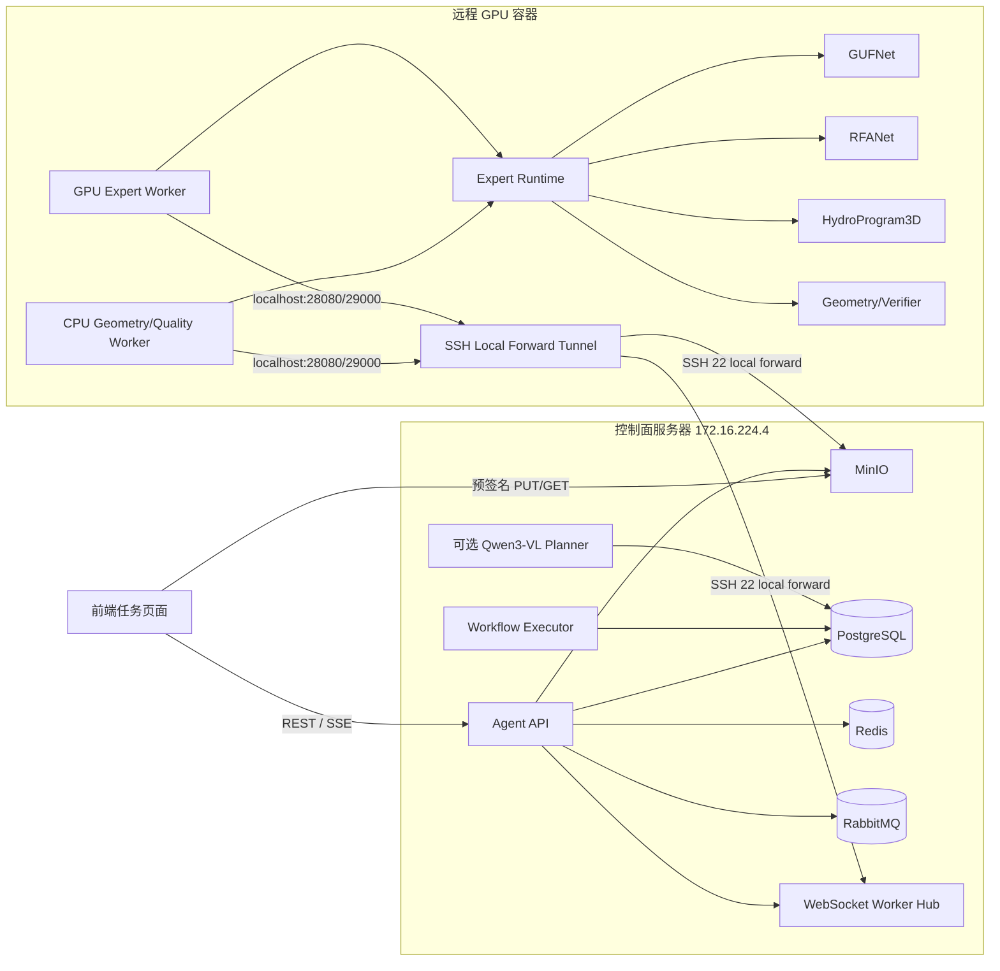

# Hydro Remote Agent 项目架构、部署与前端联调手册

本文档用于项目开发、部署、运维和前后端交接，描述 `hydro_remote_agent` 的目录结构、系统架构、五类专家、当前实际部署状态、远程 GPU 登录方式、服务恢复流程和前端 API 联调方法。

> 安全说明：本文不记录服务器密码、MinIO 密钥、数据库密码或 `WORKER_SECRET`。本地密钥保存在 `deploy/.env`，远端 Worker 密钥保存在 `deploy/.env.cpu-worker`，两者均不应提交到 Git。

## 1. 项目定位

Hydro Remote Agent 是面向水利遥感与三维点云分析的专家编排系统。它不使用单个大模型替代所有算法，而是把职责拆分为：

1. Agent/Planner 理解自然语言需求并生成结构化 `AgentAction`；
2. ToolSpec 校验工具名称、参数、输入模态和输出类型；
3. Workflow Executor 根据依赖关系执行一个或多个专家；
4. 远程 Expert Worker 执行真实模型或确定性几何算法；
5. MinIO 传输大文件，WebSocket 只传控制消息和结果元数据；
6. PostgreSQL 持久化 Job、Step、Event 和 Artifact 元数据；
7. 前端通过 REST 创建任务、通过 SSE 接收进度、通过预签名 URL 上传和下载文件。

系统当前定义五类核心专家：

| Tool 名称 | 功能 | 后端 | 运行资源 |
|---|---|---|---|
| `point_semantic_segmentation` | 点云语义分割 | GUFNet | GPU |
| `image_change_detection` | 双时相影像变化检测 | RFANet | GPU |
| `language_guided_point_segmentation` | 语言引导点云目标分割 | HydroProgram3D | GPU |
| `geometry_relation_analysis` | 邻近、上下、距离、高差和类别统计 | NumPy | CPU |
| `result_quality_verification` | 专家结果质量检查 | 确定性规则 | CPU |

GUFNet 在线仅注册 `point_semantic_segmentation`，负责点云语义分割，不注册影像—点云多模态语义分割能力。

## 2. 总体架构



### 2.1 控制面与数据面

- **控制面**：Agent API、WebSocket Hub、Job/Step/Event 状态、Worker 心跳、取消和重试。
- **数据面**：点云、影像、掩膜、概率图和报告文件全部通过 MinIO 传输。
- **原则**：WebSocket 消息中不传大文件，只传 `artifact://<id>`、任务参数、进度和结果清单。

### 2.2 一次任务的完整链路

```text
前端申请上传 URL
  -> 前端 PUT 文件到 MinIO
  -> 前端确认上传完成
  -> POST /v1/jobs 创建 Job
  -> Planner 或 planned_request 生成 AgentAction
  -> Executor 解析 workflow
  -> Agent Hub 选择具备对应 capability 的 Worker
  -> WebSocket 下发 task
  -> Worker 从 MinIO 下载 artifact 输入
  -> Expert Runtime 调用 Adapter
  -> Worker 上传结果到 MinIO
  -> Worker 回传 completed/failed
  -> Agent 持久化 Step 和 Event
  -> SSE 推送前端
  -> 前端申请下载 URL 并展示结果
```

## 3. 项目目录说明

项目主目录：

```text
D:\workspace\HydroGuardian\hydro_remote_agent
```

| 目录/文件 | 职责 |
|---|---|
| `backbones/` | Agent Backbone 和大模型相关封装 |
| `checkpoints/` | 本地模型权重占位目录；正式大权重主要位于远端 |
| `configs/` | ToolSpec、Runtime、训练、评测和远程配置 |
| `data/` | Agent SFT 数据生成、缓存和数据结构处理 |
| `deploy/` | Docker、Compose、环境变量、隧道和 Worker 启动脚本 |
| `evaluation/` | 路由、专家和端到端评测逻辑 |
| `examples/` | 请求示例及几何真实联调 fixture |
| `runtime/` | Expert Runtime、五类专家对应的六个 Tool Adapter 和模型 Engine |
| `schemas/` | `AgentAction`、`ToolSpec` 及参数校验协议 |
| `service/` | FastAPI、JobStore、WorkerHub、MinIO、Redis、RabbitMQ |
| `tests/` | 单元测试、协议测试、WebSocket、SSE 和服务测试 |
| `tools/` | API、Worker、Smoke、训练和评测 CLI 入口 |
| `training/` | Planner/Agent 训练流程 |
| `vendor/` | GUFNet 和变化检测等外部模型代码副本 |
| `workflow/` | DAG 依赖解析、变量引用和 Workflow Executor |
| `README.md` | 算法与研发说明 |
| `PROJECT_ARCHITECTURE_DEPLOYMENT_GUIDE.md` | 本文档，偏部署、运维和前端交接 |

### 3.1 关键配置

| 文件 | 用途 |
|---|---|
| `configs/tool_registry.yaml` | 五类专家对应的六个 ToolSpec、参数 Schema、输出和资源需求 |
| `configs/expert_runtime.yaml` | 五类专家对应的六个真实 Adapter 的本地/远端路径配置 |
| `configs/expert_runtime.container.yaml` | GPU Worker 容器内模型挂载路径 |
| `configs/expert_runtime.cpu.yaml` | 当前上线的 CPU 几何与质量 Worker |
| `configs/expert_runtime.smoke.yaml` | 不加载模型的协议 Smoke 配置 |
| `deploy/docker-compose.yml` | `.4` 独立控制面 Compose，固定内部网段 `10.253.21.0/24` |
| `deploy/docker-compose.worker.yml` | 支持 Docker GPU 环境时使用的远程 Worker Compose |
| `deploy/run-control-tunnel.sh` | GPU 主动连接 `.4:22` 的 SSH local-forward 重连脚本 |
| `deploy/start-reverse-tunnel.ps1` | 已停用的 Windows 转发备用脚本，不属于当前链路 |
| `deploy/.env.example` | 环境变量模板 |
| `deploy/.env` | 本机实际私有配置，禁止提交 |

### 3.2 关键代码入口

| 文件 | 用途 |
|---|---|
| `tools/agent_service_api.py` | 启动 Agent HTTP API 和 WebSocket Hub |
| `tools/agent_service_worker.py` | 启动 Planner Worker 或 Executor Worker |
| `tools/expert_worker_ws.py` | 远端 Worker 主动连接 Agent 的 WebSocket 客户端 |
| `tools/e2e_smoke.py` | WebSocket 调度协议端到端 Smoke |
| `service/api.py` | 所有 REST、SSE 和 WebSocket 路由 |
| `service/websocket_hub.py` | Worker 注册、选取、下发、心跳、取消、恢复和结果回传 |
| `service/assets.py` | Artifact Catalog 和 MinIO 上传下载 |
| `runtime/expert_runtime.py` | 根据配置加载 Adapter 并按 Tool 路由 |

## 4. Job、Step、Event 与 Artifact

### 4.1 Job 状态

```text
queued_planning -> planning -> queued_execution -> executing -> succeeded
                                                       |-> blocked_expert
                                                       |-> failed
任意可取消状态 ------------------------------------------> cancelled
```

### 4.2 Step 状态

```text
pending -> dispatched -> running -> succeeded
                               |-> failed
                               |-> lost -> 重连恢复
                               |-> cancelled
```

### 4.3 Artifact URI

系统使用稳定引用：

```text
artifact://art_xxxxxxxxxxxxxxxxxxxxxxxxxxxxxxxx
```

Agent 下发任务前会把它解析为内部 Artifact 元数据；Worker 下载到隔离目录后再把本地路径交给 Adapter。结果上传后重新变成 `artifact://...`，前端不能把 Worker 的本地文件路径当作下载地址。

## 5. 当前实际部署状态

更新时间：2026-08-07。

### 5.1 控制面服务器

| 项目 | 当前值/状态 |
|---|---|
| 服务器 | `172.16.224.4:22`，用户 `zhang_jun` |
| SSH 别名 | `hydro-agent-control` |
| 项目目录 | `/home/zhang_jun/HydroGuardian/hydro_remote_agent` |
| Agent API | `http://172.16.224.4:18080`，已运行且 healthy |
| MinIO API | `http://172.16.224.4:19000` |
| MinIO Console | 服务器本机 `http://127.0.0.1:19001` |
| PostgreSQL | Compose 内部服务，healthy |
| Redis | Compose 内部服务，healthy |
| RabbitMQ | Compose 内部服务，healthy |
| Planner | 默认关闭，使用 Compose `planner` profile 按需启用 |
| Executor | 已运行 |
| 数据迁移 | 原本地 PostgreSQL、MinIO、Agent State 和 Expert Outputs 已迁移 |
| SSH 本地转发隧道 | GPU 上 `hydro_control_tunnel`；`28080 -> .4:18080`，`29000 -> .4:19000` |
| Windows 依赖 | 已取消；Windows 不再承载容器或网络转发 |

控制面 Compose 是独立项目 `hydro-remote-agent`，没有接入 HydroGuardian Compose，也没有修改服务器上已有的 Overleaf、Portainer、QAnything 和主机级 MinIO。原 `9000/9001` 已占用，因此本项目对外使用 `19000/19001`。

### 5.2 远程 GPU 服务器

| 项目 | 当前值/状态 |
|---|---|
| SSH 地址 | `gpu.example.internal:30753` |
| SSH 用户 | `root` |
| SSH 别名 | `hydro-rt-30753` |
| 项目目录 | `/workspace/HydroGuardian` |
| Python 环境 | `python` |
| CPU Worker tmux | `hydro_expert_cpu_worker`，已运行 |
| 变化检测 Worker | `hydro_expert_change_worker`，GPU0，已运行 |
| 语言分割 Worker | `hydro_expert_language_worker`，GPU0，已运行 |
| GUFNet Worker | `hydro_expert_gufnet_worker`，GPU0，已运行 |
| 在线能力 | 五类核心专家均已注册；技术层共六个 Tool 接口 |

### 5.3 权重状态

| 专家 | 远端权重 |
|---|---|
| GUFNet | `/workspace/HydroGuardian/hydro_remote_agent/checkpoints/gufnet/epoch=242-step=16766.ckpt` |
| 变化检测 | `/workspace/HydroGuardian/hydro_remote_agent/checkpoints/change_detection/best_model.pth` |
| HydroProgram3D | `/workspace/HydroGuardian/runs/hydro_program3d/formal_wcs10m_primary_spvcnn_clip_program_v1/best.pth` |

GUFNet 和变化检测标准路径使用符号链接指向原权重，不重复复制大文件。

### 5.4 已完成的真实联调

五类核心专家对应的六个 Tool 接口均已完成真实在线调用验证。`geometry_relation_analysis` 的验证包括：

- 后端：`geometry_numpy`；
- `is_mock=false`；
- 输入 6 个点和两类标签；
- 正确选中 3 个目标点；
- Step 最终状态为 `succeeded`；
- 产生 `relation_mask.npz` 和 `geometry_report.json`；
- 两个产物均上传到 MinIO 并返回 `artifact://...`；
- 完整测试结果：`146 passed, 4 skipped`。

GPU 专家验证结果：

| Tool | 冷启动/首次调用 | 热启动 | 结果 |
|---|---:|---:|---|
| `image_change_detection` | 77.6 秒 | 2.42 秒 | `rfanet_change_detection`，三个 Artifact |
| `language_guided_point_segmentation` | 模型加载约 5 分钟 | 31.9 秒 | `hydro_program3d_inference`，四个 Artifact |
| `point_semantic_segmentation` | 257.6 秒 | 约 1.7 秒 | `gufnet_3d_inference`，三个 Artifact |
| `multimodal_semantic_segmentation` | 与点云分割共享模型 | 1.72 秒 | 四个 Artifact，当前 `image_used=false` |

四个 Worker 常驻后 GPU2 仍保留约 56 GB 空闲显存。实际显存随其他共享任务变化，重启前仍需检查 `nvidia-smi`。

### 5.5 本次 GPU 上线操作产物

本节记录 2026-08-07 使用空闲 GPU2 上线 GPU 专家时产生的可复现产物。预签名下载 URL 会过期，因此这里只保存稳定的 Job、Step 和 `artifact://` 标识。

#### 代码与配置产物

| 文件 | 用途 |
|---|---|
| `configs/expert_runtime.change_detection.yaml` | 仅启用 RFANet 变化检测，其余 Tool 禁用 |
| `configs/expert_runtime.language.yaml` | 仅启用 HydroProgram3D 语言引导分割 |
| `configs/expert_runtime.gufnet.yaml` | 启用两个共享 GUFNet 引擎的分割 Tool |
| `deploy/run-expert-change-worker.sh` | GPU2 变化检测 Worker 启动脚本 |
| `deploy/run-expert-language-worker.sh` | GPU2 HydroProgram3D Worker 启动脚本，强制 Hugging Face 离线模式 |
| `deploy/run-expert-gufnet-worker.sh` | GPU2 GUFNet Worker 启动脚本，注册两个分割 capability |
| `examples/change_smoke_before.png` | 变化检测 Smoke 前时相影像 |
| `examples/change_smoke_after.png` | 变化检测 Smoke 后时相影像 |
| `examples/language_smoke_points.txt` | 256 点 XYZRGB+标签 Smoke 点云 |

#### 运行产物

| tmux 会话 | Worker ID | 能力 | GPU |
|---|---|---|---|
| `hydro_expert_cpu_worker` | `gpu-worker-cpu-geometry` | 几何分析、质量验证 | CPU |
| `hydro_expert_change_worker` | `gpu-worker-change-gpu2` | 变化检测 | GPU2 |
| `hydro_expert_language_worker` | `gpu-worker-language-gpu2` | 语言引导点云分割 | GPU2 |
| `hydro_expert_gufnet_worker` | `gpu-worker-gufnet-gpu2` | 点云分割、多模态分割 | GPU2 |

对应远端日志：

```text
/workspace/HydroGuardian/hydro_remote_agent/runs/expert_cpu_worker.log
/workspace/HydroGuardian/hydro_remote_agent/runs/expert_change_worker.log
/workspace/HydroGuardian/hydro_remote_agent/runs/expert_language_worker.log
/workspace/HydroGuardian/hydro_remote_agent/runs/expert_gufnet_worker.log
```

#### 变化检测验收产物

```text
Job:  job_283861888f1342eaa42b2abc544be7a1
Step: real-change-step-001
Worker: gpu-worker-change-gpu2
Backend: rfanet_change_detection
Status: succeeded
```

输入为两张 `256 x 256` Smoke 影像。结果检测到 `2592` 个变化像素，变化比例 `0.03955078125`，连通区域数为 `1`。

| 产物 | Artifact URI |
|---|---|
| 变化掩膜 `change_mask.png` | `artifact://art_b2dd369721a8439db8ea764fc4c4d0de` |
| 概率图 `change_probability_map.npz` | `artifact://art_c89239e6fe184022a75b02eb522a24da` |
| 区域报告 `change_regions.json` | `artifact://art_390709202edd4565889aa5317e4356ba` |
| Expert manifest | `artifact://art_96bdab10fef542ae93b19f39ea87c038` |

#### HydroProgram3D 验收产物

```text
Job:  job_b3b293fa45e44d64adea00665d45e8d1
Step: real-language-step-002
Worker: gpu-worker-language-gpu2
Backend: hydro_program3d_inference
Status: succeeded
```

输入为 `256` 个点和查询 `segment the road points`。本次人工 Smoke 样本的执行置信度为 `0.7308028936386108`，未 abstain，未判定 no-target；预测掩膜为空只反映该人工样本，不代表模型加载或服务失败。

| 产物 | Artifact URI |
|---|---|
| 目标掩膜 | `artifact://art_3935b9be31e14720901f0f860b7edc55` |
| 目标概率 | `artifact://art_cd594e86f6064b69a9ef096d74046d9d` |
| 采样元数据 | `artifact://art_dec1e4f752a6474c99e6b2a24ba2248a` |
| 编译程序 | `artifact://art_6c2eceeda2f140b89cef62216f691a88` |
| Expert manifest | `artifact://art_65712527da0e4f2f88bbd43e61afd5a2` |

#### GUFNet 点云分割验收产物

```text
Job:  job_949a8c7f274c45b9a793c64afbac1e9e
Step: real-gufnet-step-001
Worker: gpu-worker-gufnet-gpu2
Backend: gufnet_3d_inference
Status: succeeded
```

输入为 `256` 个点。模型返回一个当前存在类别，`image_used=false`。多模态 Tool 另行完成热启动验证并生成 `projection_metadata`，确认影像文件会被校验，但当前模型推理仍只使用点云分支。

| 产物 | Artifact URI |
|---|---|
| 点标签 `point_labels.npz` | `artifact://art_edf9b22a087d414e98b7bfe12ad42d6f` |
| 类别掩膜 `class_masks.npz` | `artifact://art_b4f11d13480d4c6fb4bbc2747b9fcdf9` |
| 类别概率 `class_probabilities.npz` | `artifact://art_76eac484158e417d9d0c766e78b9e377` |
| Expert manifest | `artifact://art_d75dfee6924a4834bb611e2c36c67226` |

多模态热启动调用额外产生：

| 产物 | Artifact URI |
|---|---|
| 点标签 | `artifact://art_d1a8c6b803f74090aa3d4aa28b8e18a2` |
| 类别掩膜 | `artifact://art_cf588533ac1b4780bc78a29b1d3d1c4e` |
| 类别概率 | `artifact://art_02e921ecb7bc4c289a69b9f34f5049ca` |
| 投影元数据 | `artifact://art_658731dd7e3840feb0bf20d8df50934c` |

#### 验收时资源状态

```text
GPU: 2 (NVIDIA A100-SXM4-80GB)
常驻显存: 24795 MiB
剩余显存: 56242 MiB
在线 Worker: 4
在线 Tool capability: 6
测试: 146 passed, 4 skipped
```

查询这些产物时使用：

```http
GET /v1/assets/{artifact_id}
GET /v1/assets/{artifact_id}/download
```

不要保存预签名 URL；需要下载时根据 Artifact ID 重新申请。

### 5.6 控制面服务器迁移产物

2026-08-07 已把本地工作站上的全部控制面容器迁移到 `172.16.224.4`，并保留原有历史 Job、Step、Event 与 Artifact 元数据。迁移备份保存在目标服务器：

```text
/home/zhang_jun/HydroGuardian/hydro_remote_agent/.migration/20260807-control-plane/
```

该目录包含 PostgreSQL 逻辑备份，以及 MinIO、Agent State、Expert Outputs 的卷归档。它包含私有数据，权限为 `600`，不要提交到 Git。

迁移后网络排障发现 GPU 出口地址为 `172.24.128.119`，与 Docker 自动分配的 `172.24.0.0/16` 重叠，导致 `.4` 把回包误发到 Docker 网桥。`deploy/docker-compose.yml` 已将项目内部网络固定为 `10.253.21.0/24`，禁止再改回与 GPU、校园网或 VPN 重叠的网段。修复后 GPU 可直连 `.4:22`，但上游 ACL 仍丢弃 `18080/19000`，因此应用流量封装在 GPU 主动建立的 SSH `22` 本地转发隧道中。

迁移后新增的真实验收记录：

| 验收项 | Job / Step | 结果 |
|---|---|---|
| 几何分析 | `job_17a8a48ffbb24390a4b3104c35f41142` / `migration-geometry-60bbee7803` | `geometry_numpy`，`is_mock=false`，成功 |
| 变化检测 | `job_f1399a0355f4426da23947edce0d7df4` / `migration-change-44adf43c6d` | `rfanet_change_detection`，GPU0，成功 |
| 网络修复后复验 | `job_df242099c5634e7db51bbada11a04871` / `network-fix-4b237988ec` | 经 GPU 自管 SSH 隧道调用并下载 Artifact，成功 |

| 新产物 | Artifact URI |
|---|---|
| 几何关系掩膜 | `artifact://art_f2bda0aeaa464a2c8e188a57cc8495c6` |
| 几何报告 | `artifact://art_50d1124008514e579d2333bc247f84dd` |
| 几何 manifest | `artifact://art_c72856f860804956a0448f32c16bb352` |
| 变化掩膜 | `artifact://art_211c9d7b45134263b17bfac214c5db20` |
| 变化概率图 | `artifact://art_f74dcca19df94972a5702e0822d06b40` |
| 变化区域报告 | `artifact://art_d2ca78ea757f4882ad4236af700bd802` |
| 变化检测 manifest | `artifact://art_9fbd3c1e5ccc48ef961edb8221350e81` |
| 网络修复复验几何报告 | `artifact://art_d25056ef117b46008da456b625d57062` |

上述产物均已通过 `GET /v1/assets/{artifact_id}/download` 从新 MinIO 下载并校验 SHA-256。

## 6. 控制面服务器部署

登录并进入部署目录：

```bash
ssh hydro-agent-control
cd /home/zhang_jun/HydroGuardian/hydro_remote_agent
```

目标服务器私有配置为 `deploy/.env`，权限必须为 `600`。当前关键主机项：

```dotenv
AGENT_API_PORT=18080
ASSET_DIR=/home/zhang_jun/HydroGuardian/hydro_remote_agent/data/assets
MINIO_PUBLIC_ENDPOINT=172.16.224.4:19000
MINIO_API_PORT=19000
MINIO_CONSOLE_PORT=19001
```

Compose 默认网络固定为 `10.253.21.0/24`。修改该网段前必须同时检查 `ip route`、GPU 出口地址和校园网网段，避免回程路由冲突。

启动：

```bash
docker compose --env-file deploy/.env -f deploy/docker-compose.yml config
docker compose --env-file deploy/.env -f deploy/docker-compose.yml build agent
docker compose --env-file deploy/.env -f deploy/docker-compose.yml up -d
docker compose --env-file deploy/.env -f deploy/docker-compose.yml ps
curl http://127.0.0.1:18080/healthz
```

查看日志：

```bash
docker compose --env-file deploy/.env -f deploy/docker-compose.yml logs -f agent
```

停止但保留数据：

```bash
docker compose --env-file deploy/.env -f deploy/docker-compose.yml stop
```

不要随意执行 `docker compose down -v`，`-v` 会删除 PostgreSQL、MinIO、Redis 等持久化卷。

### 6.1 可选 Planner

默认控制面不加载 Planner，因此不需要 GPU。Planner 权重准备好且目标机具备可用 GPU 后执行：

```bash
docker compose --env-file deploy/.env -f deploy/docker-compose.yml --profile planner up -d planner
```

如果 Planner 未启用，前端提交没有 `planned_request` 的 Job 会停在 `queued_planning`。当前联调阶段应：

1. 启用 Planner；或
2. 由后端/BFF 生成并传入合法 `planned_request`。

## 7. 服务器登录

### 7.1 SSH 配置

本机配置文件：

```text
C:\Users\ilotus\.ssh\config
```

推荐条目：

```sshconfig
Host hydro-agent-control
    HostName 172.16.224.4
    User zhang_jun
    Port 22
    IdentityFile ~/.ssh/id_ed25519_hydro_agent_control
    IdentitiesOnly yes

Host hydro-rt-30753
    HostName gpu.example.internal
    User root
    Port 30753
    IdentityFile ~/.ssh/id_ed25519_hydro3d
    IdentitiesOnly yes
```

登录：

```powershell
ssh hydro-agent-control
ssh hydro-rt-30753
```

控制面项目目录为 `/home/zhang_jun/HydroGuardian/hydro_remote_agent`。密码仅用于首次配置公钥，日常登录使用 SSH 密钥；文档和仓库中不得记录服务器密码。

不使用别名时：

```powershell
ssh -i $HOME/.ssh/id_ed25519_hydro3d -p 30753 root@gpu.example.internal
```

复制文件：

```powershell
scp -P 30753 -i $HOME/.ssh/id_ed25519_hydro3d `
  .\local-file `
  root@gpu.example.internal:/workspace/HydroGuardian/
```

### 7.2 常用 GPU 端检查

```bash
cd /workspace/HydroGuardian
nvidia-smi
tmux ls
ps -eo pid,cmd | grep expert_worker_ws | grep -v grep
tail -f hydro_remote_agent/runs/expert_cpu_worker.log
```

检查 CPU Worker：

```bash
tmux has-session -t hydro_expert_cpu_worker && echo OK
```

进入 tmux：

```bash
tmux attach -t hydro_expert_cpu_worker
```

离开但不停止：按 `Ctrl+B`，再按 `D`。

## 8. GPU 到控制面的 SSH 隧道

GPU 可以访问 `.4` 的 ICMP、SSH `22` 和部分常见 Web 端口，但上游 ACL 会在数据包到达 `.4` 前丢弃 `18080/19000`。因此由 GPU 主动连接 `.4:22`，并在 GPU 本机建立两个 local forward：

```text
GPU 127.0.0.1:28080 -> SSH 22 -> .4 127.0.0.1:18080 Agent
GPU 127.0.0.1:29000 -> SSH 22 -> .4 127.0.0.1:19000 MinIO
```

专用私钥位于 GPU 的 `/root/.ssh/id_ed25519_hydro_control`，公钥已加入 `.4` 用户 `zhang_jun` 的 `authorized_keys`。私钥不得复制到仓库或交接文档。

GPU 端启动：

```bash
cd /workspace/HydroGuardian/hydro_remote_agent
tmux kill-session -t hydro_control_tunnel 2>/dev/null || true
tmux new-session -d -s hydro_control_tunnel \
  'bash deploy/run-control-tunnel.sh >> logs/control-tunnel.log 2>&1'
```

检查：

```bash
tmux has-session -t hydro_control_tunnel && echo OK
pgrep -af 'ssh.*id_ed25519_hydro_control'
curl http://127.0.0.1:28080/healthz
curl http://127.0.0.1:29000/minio/health/live
```

`run-control-tunnel.sh` 内含重连循环，SSH 会话异常后每 5 秒重试。GPU 容器重启后 tmux 不会自动恢复，必须先启动该隧道，再启动四个 Worker。Windows 的旧隧道进程和 `HydroAgentReverseTunnel` 计划任务已删除，当前链路不依赖 Windows 在线。

## 9. 远端 Worker 启动

### 9.1 当前 CPU Worker

远端私有环境文件：

```text
/workspace/HydroGuardian/hydro_remote_agent/deploy/.env.cpu-worker
```

权限应为 `600`，包含与本地一致的 `WORKER_SECRET` 及 MinIO Worker 账号，不应包含 MinIO Root 密钥。

启动：

```bash
cd /workspace/HydroGuardian
tmux kill-session -t hydro_expert_cpu_worker 2>/dev/null || true
tmux new-session -d -s hydro_expert_cpu_worker \
  'cd hydro_remote_agent && bash deploy/run-expert-cpu-worker.sh >> logs/cpu-worker.log 2>&1'
```

本地确认注册：

```powershell
Invoke-RestMethod http://172.16.224.4:18080/v1/workers | ConvertTo-Json -Depth 10
```

### 9.2 GPU Worker

GPU Worker 支持两种方式：

1. 有 Docker/NVIDIA Container Toolkit 时使用 `deploy/docker-compose.worker.yml`；
2. 当前远端容器没有 Docker，直接使用 Conda Python 启动 `tools/expert_worker_ws.py`。

当前三个 GPU Worker 均绑定物理 GPU0。启动前必须执行：

```bash
nvidia-smi
```

确认选定 GPU 有足够显存后，再设置 `CUDA_VISIBLE_DEVICES` 并只注册已经完成健康检查的能力。不要让未准备好的 Adapter 出现在 Worker capabilities 中。

恢复三个 GPU Worker：

```bash
tmux new-session -d -s hydro_expert_change_worker \
  'cd hydro_remote_agent && EXPERT_GPU_ID=0 WORKER_ID=gpu-worker-change-gpu0 bash deploy/run-expert-change-worker.sh >> logs/change-worker.log 2>&1'
tmux new-session -d -s hydro_expert_language_worker \
  'cd hydro_remote_agent && EXPERT_GPU_ID=0 WORKER_ID=gpu-worker-language-gpu0 bash deploy/run-expert-language-worker.sh >> logs/language-worker.log 2>&1'
tmux new-session -d -s hydro_expert_gufnet_worker \
  'cd hydro_remote_agent && EXPERT_GPU_ID=0 WORKER_ID=gpu-worker-gufnet-gpu0 bash deploy/run-expert-gufnet-worker.sh >> logs/gufnet-worker.log 2>&1'
```

GUFNet 冷启动约 4-5 分钟，HydroProgram3D 冷启动约 5 分钟。启动脚本已设置 Hugging Face 离线模式，避免模型启动时访问外网。

## 10. 前端联调

### 10.1 基础地址

推荐前端使用同源代理：

```text
浏览器请求 /hydro-api/*
开发服务器代理到 http://172.16.224.4:18080/*
```

当前 FastAPI 没有配置 CORS。前端如果从 `http://localhost:5173` 直接访问 `http://172.16.224.4:18080`，浏览器会执行跨域限制。当前推荐：

- Vite/Webpack 开发代理；
- HydroGuardian 或其他后端作为 BFF 反向代理；
- 正式部署时由同源网关统一代理 Agent 和 MinIO。

不要让浏览器调用 `/internal/*`，这些接口只供 Executor、Worker 和运维 Smoke 使用。

### 10.2 Vite 开发代理示例

```ts
// vite.config.ts
export default defineConfig({
  server: {
    proxy: {
      "/hydro-api": {
        target: "http://172.16.224.4:18080",
        changeOrigin: true,
        rewrite: (path) => path.replace(/^\/hydro-api/, ""),
      },
    },
  },
});
```

前端 API Base URL：

```ts
const API_BASE = "/hydro-api";
```

### 10.3 文件上传流程

第一步，申请预签名上传 URL：

```http
POST /v1/assets/presign
Content-Type: application/json

{
  "filename": "tile_001.npy",
  "media_type": "application/octet-stream",
  "tenant_id": "default",
  "job_id": "uploads"
}
```

响应包含：

```json
{
  "artifact": {
    "artifact_id": "art_xxx",
    "bucket": "hydro-input",
    "object_key": "default/uploads/input/art_xxx/tile_001.npy",
    "media_type": "application/octet-stream"
  },
  "upload_url": "http://...presigned-put-url...",
  "artifact_uri": "artifact://art_xxx"
}
```

第二步，直接 PUT 文件：

```ts
await fetch(uploadUrl, {
  method: "PUT",
  headers: { "Content-Type": file.type || "application/octet-stream" },
  body: file,
});
```

第三步，确认上传：

```http
POST /v1/assets/art_xxx/complete
Content-Type: application/json

{
  "metadata": {
    "original_name": "tile_001.npy"
  }
}
```

注意：浏览器直接 PUT 到 MinIO 也可能需要 MinIO CORS。若浏览器环境仍被拦截，应由 BFF 代传文件，或由运维为指定前端源配置 MinIO CORS，不要开放通配来源和凭据。

### 10.4 创建 Job

启用 Planner 时可以只传自然语言和资产：

```http
POST /v1/jobs
Idempotency-Key: web-20260806-001
Content-Type: application/json

{
  "request_id": "web-20260806-001",
  "query": "统计类别 1 的点云几何范围",
  "language": "zh",
  "assets": {
    "point_cloud_path": "artifact://art_points",
    "segmentation_result_path": "artifact://art_labels"
  }
}
```

当前 Planner 默认关闭，因此联调时需要携带 `planned_request`。几何工作流示例：

```json
{
  "request_id": "web-geometry-001",
  "query": "统计类别 1 的点云范围",
  "language": "zh",
  "assets": {
    "point_cloud_path": "artifact://art_points",
    "segmentation_result_path": "artifact://art_labels"
  },
  "planned_request": {
    "schema_version": "1.0",
    "request_id": "web-geometry-001",
    "intent": "geometry_analysis",
    "action": {
      "type": "tool_call",
      "tool": "geometry_relation_analysis",
      "arguments": {
        "point_cloud_path": "artifact://art_points",
        "segmentation_result_path": "artifact://art_labels",
        "operation": "class_statistics",
        "target_class_id": 1
      }
    },
    "expected_output": {
      "type": "geometry_report",
      "coordinate_space": "source_point_cloud"
    }
  }
}
```

`request_id` 和 `Idempotency-Key` 应由前端或 BFF 稳定生成。网络重试时保持相同值，避免创建重复任务。

### 10.5 查询和 SSE 进度

创建 Job 后保存返回的 `job_id`。

普通查询：

```http
GET /v1/jobs/{job_id}
GET /v1/jobs/{job_id}/steps
GET /v1/jobs/{job_id}/events
```

SSE：

```ts
const source = new EventSource(
  `${API_BASE}/v1/jobs/${jobId}/events/stream?last_event_id=${lastEventId}`,
);

source.addEventListener("job", (event) => {
  const payload = JSON.parse((event as MessageEvent).data);
  lastEventId = payload.event_id;
  updateJobTimeline(payload);
});

source.onerror = () => {
  source.close();
  // 使用保存的 lastEventId 重连，或回退到 GET /events。
};
```

前端建议显示：

- Job 总状态；
- 每个 Step 的 `tool`、`status`、`progress`、`phase`；
- Worker 断线产生的 `lost`；
- `failed` 的错误码和信息；
- 结果 Artifact 列表。

### 10.6 取消与重试

```http
POST /v1/jobs/{job_id}/cancel
POST /v1/jobs/{job_id}/retry
```

运行中的任务取消可能返回 `409`，响应会说明是否已经向 Worker 发送取消消息。前端不能把所有 `409` 都显示为普通失败，应展示“取消请求已发送，等待 Worker 确认”。

### 10.7 下载结果

对于 `artifact://art_xxx`：

```http
GET /v1/assets/art_xxx/download
```

响应：

```json
{
  "artifact_id": "art_xxx",
  "download_url": "http://...presigned-get-url..."
}
```

前端再使用 `download_url` 下载或展示文件。预签名 URL 有有效期，不应长期缓存；长期保存的是 `artifact_id`。

### 10.8 推荐前端页面状态模型

```ts
type JobStatus =
  | "queued_planning"
  | "planning"
  | "queued_execution"
  | "executing"
  | "succeeded"
  | "blocked_expert"
  | "failed"
  | "cancelled";

type StepStatus =
  | "pending"
  | "dispatched"
  | "running"
  | "succeeded"
  | "failed"
  | "lost"
  | "cancelled";
```

任务页面至少包括：文件上传区、自然语言输入、任务状态、Step 时间线、错误详情、结果预览和 Artifact 下载入口。

## 11. API 清单

### 11.1 前端公开 API

| 方法 | 路径 | 用途 |
|---|---|---|
| `GET` | `/healthz` | 服务与队列健康状态 |
| `GET` | `/v1/workers` | 在线 Worker 和能力，用于运维页面 |
| `POST` | `/v1/assets/presign` | 申请上传 URL |
| `POST` | `/v1/assets/{id}/complete` | 确认上传并记录元数据 |
| `GET` | `/v1/assets/{id}` | 查询 Artifact 元数据 |
| `GET` | `/v1/assets/{id}/download` | 获取预签名下载 URL |
| `POST` | `/v1/jobs` | 创建任务 |
| `GET` | `/v1/jobs` | 查询任务列表 |
| `GET` | `/v1/jobs/{id}` | 查询单个任务 |
| `GET` | `/v1/jobs/{id}/steps` | 查询步骤 |
| `GET` | `/v1/jobs/{id}/events` | 查询历史事件 |
| `GET` | `/v1/jobs/{id}/events/stream` | SSE 实时事件 |
| `GET` | `/v1/jobs/{id}/messages` | 查询任务对话与人工干预记录 |
| `POST` | `/v1/jobs/{id}/messages` | 状态询问或补充任务上下文 |
| `POST` | `/v1/jobs/{id}/interventions` | 经确认后停止任务或创建重规划任务 |
| `GET` | `/v1/jobs/{id}/artifacts` | 查询 Workflow 终态产物 |
| `POST` | `/v1/jobs/{id}/cancel` | 取消任务 |
| `POST` | `/v1/jobs/{id}/retry` | 重试失败任务 |

### 11.2 内部 API

| 方法 | 路径 | 用途 |
|---|---|---|
| `POST` | `/internal/tools/{tool}/prepare` | 检查具备能力的 Worker |
| `POST` | `/internal/tools/{tool}/invoke` | Executor/Smoke 直接调用专家 |
| `WS` | `/internal/workers/ws` | Worker 注册、心跳和任务通道 |

内部 API 不应直接暴露给浏览器用户。

## 12. 服务恢复顺序

任一节点重启后按以下顺序恢复：

1. SSH 登录 `hydro-agent-control`；
2. 在 `/home/zhang_jun/HydroGuardian/hydro_remote_agent` 启动 Compose；
3. 检查 `http://172.16.224.4:18080/healthz`；
4. SSH 登录 `hydro-rt-30753`；
5. 启动 GPU 端 `hydro_control_tunnel` tmux；
6. 验证 GPU 本机 `28080/29000` 后启动 `hydro_expert_cpu_worker`；
7. 查询 `http://172.16.224.4:18080/v1/workers`；
8. 检查 GPU0 或其他拟使用 GPU 的余量后启动三个 GPU Worker；
9. 前端创建 Smoke Job 验证 SSE 和结果下载。

快速检查：

```powershell
Invoke-RestMethod http://172.16.224.4:18080/healthz
Invoke-RestMethod http://172.16.224.4:18080/v1/workers | ConvertTo-Json -Depth 10
ssh hydro-agent-control "cd /home/zhang_jun/HydroGuardian/hydro_remote_agent && docker compose --env-file deploy/.env -f deploy/docker-compose.yml ps"
```

## 13. 常见问题

### Worker 不在线

依次检查：

1. `.4` 上的 Agent 是否 healthy；
2. GPU 的 `hydro_control_tunnel` tmux 和 SSH 进程是否存在；
3. 远端 `curl http://127.0.0.1:28080/healthz`；
4. `WORKER_SECRET` 两端是否一致；
5. tmux 和 Worker 日志；
6. Worker capability 是否包含目标 Tool。

### Job 一直停在 queued_planning

Planner 未启动且请求没有 `planned_request`。启用 Planner，或由 BFF 提供合法的 `planned_request`。

### 返回 No online worker supports tool

没有在线 Worker 注册该能力。不要通过伪造 capability 绕过，应先完成对应 Adapter 的权重、依赖和 `health_check`。

### 浏览器跨域失败

Agent 当前未配置 CORS。使用 Vite/BFF 同源代理；MinIO PUT 仍失败时配置限定来源的 MinIO CORS 或改由 BFF 上传。

### Artifact 下载失败

确认使用 `/v1/assets/{artifact_id}/download`，不是 `/v1/artifacts/...`。重新申请预签名 URL，不要复用过期 URL。

### GPU Worker 是否可以立即启动

先运行 `nvidia-smi`。当前 Worker 使用 GPU0，但服务器是共享环境，不能仅因为权重存在就盲目重启全部模型。应确认目标 GPU 余量，并逐个检查 tmux、日志和 `/v1/workers`。

## 14. 安全与生产化注意事项

当前部署用于校园网研发联调，正式对外前还需完成：

- API 身份认证和租户隔离；
- 前端用户与 Job/Artifact 所有权校验；
- `/internal/*` 网络隔离；
- Nginx/TLS；
- 限定来源的 CORS；
- 密钥管理，不使用示例密码；
- SSH 隧道和 Worker 的系统级守护；
- 上传文件大小、类型、数量和病毒扫描限制；
- PostgreSQL、MinIO 的备份与恢复演练；
- Prometheus/Grafana 指标和告警；
- GPU OOM、Worker 断线、MinIO 超时和任务重复的故障演练。

## 15. 下一阶段

建议按以下顺序继续：

1. 使用真实 WCS10M tile 执行六专家综合验收；
2. 验证“分割 -> 几何关系 -> 质量验证”完整 Workflow；
3. 实现前端任务页面和 BFF 同源代理；
4. 部署 Planner 并验证自然语言自动路由；
5. 最后补充认证、TLS、监控和自动拉起服务。
