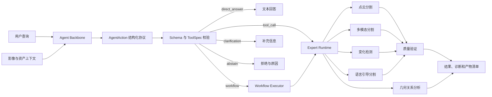

# VagueHydro Agent

VagueHydro Agent（代码包名为 `hydro_remote_agent`）是一个面向水利遥感场景的能力感知型
Agent 系统。它接收自然语言问题和场景资产，根据任务粒度决定直接回答、调用单个专家、
编排多个专家、追问缺失信息或拒绝不可靠请求。

部署、目录、远程 GPU 登录和前端联调请见
[`PROJECT_ARCHITECTURE_DEPLOYMENT_GUIDE.md`](PROJECT_ARCHITECTURE_DEPLOYMENT_GUIDE.md)。

本项目不试图用一个大模型替代所有遥感算法。核心思路是让 Agent 负责理解意图、选择能力、
生成结构化参数和组织执行，让经过训练或规则验证的专家模型负责点级分割、变化检测与几何计算。

> 当前状态：ToolSpec、Action 协议、Expert Runtime、统一 Agent Executor、五类真实专家对应的 6 个 Tool Adapter、
> VagueHydro 数据流水线、Qwen3-VL Backbone、LoRA SFT 与持久化在线服务已经实现，并完成
> Agent Eval v1、真实专家离线评测和在线端到端冒烟；
> `language_guided_point_segmentation` 的真实 Adapter、最终 `best.pth` 和 1,903 条正式质量评测
> 已完成；历史 50 条跳过请求已补跑，完整 240 条端到端执行不再包含 Mock；无 verifier、
> 无 workflow、无语言专家三组系统消融已完成。当前正式训练结果以 LoRA SFT 为准；
> 偏好优化相关脚本仅用于研究性试验，尚未作为正式发布结果。

## 文档导航

- [项目要解决的问题](#1-项目要解决的问题)
- [总体架构](#2-总体架构)
- [AgentAction 协议](#3-agentaction-协议)
- [五类核心专家](#4-五类核心专家)
- [运行时与工作流](#5-运行时与工作流)
- [数据集与标签空间](#6-数据集与标签空间)
- [VagueHydro 训练数据](#7-vaguehydro-训练数据)
- [最终 Agent 的输入与输出规划](#8-最终-agent-的输入与输出规划)
- [Agent 训练实施路线](#9-agent-训练实施路线)
- [评测方案](#10-评测方案)
- [快速开始](#11-快速开始)
- [目录结构](#12-目录结构)
- [远端部署](#13-远端部署)
- [当前完成度](#14-当前完成度)
- [已知限制](#15-已知限制)
- [下一步](#16-下一步)

## 1. 项目要解决的问题

水利遥感用户通常不会直接说出模型名称或标准类别，而会提出不同粒度的问题，例如：

- “这里有沟渠吗？”
- “把大面积连续林地对应的点找出来。”
- “哪些土路点靠近裸地？”
- “这两个时期发生变化的区域在哪里？”
- “结果置信度够不够，能不能用于后续测量？”

这些请求需要不同的处理方式：

| 请求类型 | Agent 行为 |
|---|---|
| 简单判断或数据集信息 | `direct_answer` |
| 单一稠密预测 | `tool_call` |
| 分割后继续做空间关系分析 | `workflow` |
| 缺少影像、点云、时相或阈值 | `clarification` |
| 超出能力、输入无效或结果不可靠 | `abstain` |

最终目标不是只提高某一个分割模型的指标，而是提高从模糊请求到可验证遥感结果的端到端成功率。

## 2. 总体架构



系统分为五层：

1. **Agent 层**：理解用户表达，预测意图和执行方式。
2. **协议层**：用 `AgentAction` 和 `ToolSpec` 约束工具名称、参数、输出与依赖。
3. **执行层**：加载 Adapter、管理模型生命周期并执行单工具或工作流。
4. **专家层**：运行分割、变化检测、几何计算和质量验证。
5. **数据与评测层**：构建中英文 L0-L3 数据，训练 Agent 并评估路由与端到端执行。

## 3. AgentAction 协议

Agent 的输出不是自由文本工具指令，而是版本化 JSON。当前支持五种动作：

| 动作 | 用途 |
|---|---|
| `direct_answer` | 直接返回文本 |
| `tool_call` | 调用一个专家 |
| `workflow` | 按依赖关系执行多个专家 |
| `clarification` | 询问缺失字段 |
| `abstain` | 给出拒绝原因、错误码及是否可恢复 |

一个关系分割工作流示例：

```json
{
  "schema_version": "1.0",
  "request_id": "demo_relation_01",
  "intent": "relation_segmentation",
  "action": {
    "type": "workflow",
    "steps": [
      {
        "step_id": "segment",
        "tool": "point_semantic_segmentation",
        "arguments": {
          "point_cloud_path": "tile.txt",
          "target_class_ids": [4, 13]
        }
      },
      {
        "step_id": "relation",
        "tool": "geometry_relation_analysis",
        "depends_on": ["segment"],
        "arguments": {
          "point_cloud_path": "tile.txt",
          "segmentation_result_path": "${segment.artifacts.point_labels}",
          "operation": "near",
          "target_class_id": 4,
          "reference_class_id": 13,
          "distance_threshold_m": 3.0
        }
      }
    ]
  },
  "expected_output": {
    "type": "point_mask",
    "coordinate_space": "source_point_cloud"
  }
}
```

协议会在执行前检查：

- 工具是否存在；
- 参数是否满足对应 JSON Schema；
- 输出类型和坐标空间是否兼容；
- 工作流依赖是否只引用前序步骤；
- `${step.artifacts.name}` 是否引用真实产物；
- 需要验证的工具是否注册了 verifier。

## 4. 五类核心专家

五类专家统一定义在 `configs/tool_registry.yaml`，部署后端定义在
`configs/expert_runtime.yaml`。

| 专家 | 主要输入 | 主要输出 | 当前后端 | 状态 |
|---|---|---|---|---|
| `point_semantic_segmentation` | 点云 | 15 类点标签、类别掩膜、概率 | GUFNet 3D | 真实 Adapter |
| `image_change_detection` | 前时相影像、后时相影像 | 变化掩膜、概率图、连通区域 | RFANet | 真实 Adapter |
| `language_guided_point_segmentation` | 影像、点云、自然语言 | 目标点掩膜、概率 | HydroProgram3D | 真实 Adapter，正式权重已评测 |
| `geometry_relation_analysis` | 点云、分割结果 | 关系掩膜、几何统计报告 | NumPy | 真实 Adapter |
| `result_quality_verification` | 专家结果清单及可选原始资产 | 质量报告、诊断信息 | 确定性规则 | 真实 Adapter |

GUFNet 在线仅注册 `point_semantic_segmentation`，负责点云语义分割，不提供独立的影像—点云多模态语义分割接口。

### 4.1 GUFNet 分割

点云语义分割 Tool 使用 `GufnetInferenceEngine`，模型在进程内只加载一次；派生 Tool 接口复用同一 Engine。

- 标签空间使用原始类别 ID `1..15`；
- 推理只加载 checkpoint 中的 `model_3d.*` 权重；
- 输入为 XYZRGB 点云，XYZ 减去场景质心，RGB 保持原值；
- 输出为 `(N,)` 点标签和 `(N, 15)` 类别概率。

需要特别说明：GUFNet 在训练时使用影像与点云信息，但当前部署的评估路径只执行点云分支。
因此 `multimodal_semantic_segmentation` 会验证影像文件存在，但推理元数据中
`image_used=false`。这不是在线影像融合模型。

### 4.2 RFANet 变化检测

变化检测 Adapter 接收已配准且尺寸一致的前后时相影像：

1. 拼接两个 RGB 时相；
2. 归一化并缩放到配置尺寸；
3. 运行 RFANet；
4. 恢复到原始影像尺寸；
5. 按阈值生成二值变化掩膜；
6. 可过滤小连通域并输出区域统计。

### 4.3 语言引导点云分割

`HydroProgram3DAdapter` 已接入 checkpoint、查询编译器和模型推理接口，处理类别、属性、
关系和 no-target 请求。部署输入只保留影像、点云和查询，不加载训练监督字段。

- XYZ 与 RGB 使用和训练一致的预处理；
- 点数超过 checkpoint 的 `max_points` 时执行固定种子采样；
- 采样点概率通过最近邻映射回完整源点云；
- 输出完整长度的 `target_mask`、`target_probabilities`、采样元数据和编译程序；
- manifest 记录执行置信度、abstention、no-target 和几何缓存使用情况；
- `result_quality_verification` 独立验证二值掩膜、概率和源点数一致性。

中间 checkpoint 只用于 2--5 条接口冒烟。245 tile 对应的全部冻结语言任务评测和 50 条
历史跳过请求重跑，只使用训练完成后固定的最终 `best.pth`。

### 4.4 几何关系分析

这是确定性后处理专家，不需要训练。当前支持：

- `near`：基于水平欧氏距离和阈值选择目标点；
- `above`：相对参照类别中位高程加 `z_margin_m`；
- `class_statistics`：点数、比例和空间范围；
- `pair_distance`：类别间距离统计；
- `elevation_difference`：类别间高差统计。

### 4.5 质量验证

质量验证器不会重新预测类别，而是检查专家产物是否可信和自洽：

- 标签是否为一维原始 ID `1..15`；
- 点数量是否与源点云一致；
- 概率是否有限、位于 `[0, 1]` 且逐行归一化；
- 平均置信度和低置信度比例；
- 变化掩膜是否为二值且与概率图对齐；
- 空结果、异常主导类别和缺失产物；
- 必要时给出 warning 或建议 abstain。

## 5. 运行时与工作流

`ExpertRuntime` 为每个 Tool 注册一个 Adapter，并统一提供：

- `prepare()`：加载模型或准备资源；
- `health_check()`：检查可用性；
- `predict()`：执行经过 ToolSpec 校验的调用；
- `shutdown()`：释放模型与 CUDA 资源。

`WorkflowExecutor` 负责：

- 按依赖顺序准备和执行专家；
- 解析前序步骤产物引用；
- 自动调用 verifier；
- 依赖失败时跳过后续步骤；
- 汇总终端产物、warning、耗时和 Mock 状态；
- 写入 `workflow_manifest.json`。

每次专家调用都会生成独立结果目录和 manifest，避免下游依赖控制台文本。

## 6. 数据集与标签空间

项目使用 WCS 10M 水利遥感数据，固定按 tile 划分：

| Split | Tile 数 |
|---|---:|
| train | 1,145 |
| val | 246 |
| test | 245 |
| 总计 | 1,636 |

15 类原始标签：

| ID | 类别 | ID | 类别 | ID | 类别 |
|---:|---|---:|---|---:|---|
| 1 | Shed | 6 | Scarp | 11 | Woodland |
| 2 | Concretehouse | 7 | Dam | 12 | Bareland |
| 3 | Cementroad | 8 | Vegetablefield | 13 | Waterline |
| 4 | Dirtroad | 9 | Grassland | 14 | Ditch |
| 5 | Slope | 10 | Dryland | 15 | Others |

远端主要路径记录在 `configs/remote_gpu.yaml`。路径映射用于把原始服务器路径、本地
`E:/dataset/point-image-text/10M` 和当前远端数据根目录统一到同一 tile。

## 7. VagueHydro 训练数据

### 7.1 确定性 canonical 数据

`data/vague_hydro.py` 首先构建不依赖 LLM 的金标准动作：

1. 读取原始 image-point-language 标注；
2. 应用固定 tile split；
3. 将判断语义规范化成与 `direct_answer` 一致的问题；
4. 将原始措辞保存在 provenance 中；
5. 为类别、属性、关系和 no-target 派生点级请求；
6. 每个 tile 增加一个全场 15 类分割请求；
7. 用 ToolSpec 和 AgentAction Schema 审计全部动作；
8. 检查资产路径和跨 split 文本碰撞。

当前 canonical 统计：

| 项目 | 数量 |
|---|---:|
| tile manifest | 1,636 |
| canonical actions | 22,232 |
| `direct_answer` | 10,298 |
| `tool_call` | 10,271 |
| `workflow` | 1,663 |
| train queries | 14,295 |
| val queries | 3,886 |
| test queries | 4,051 |

主要产物位于 `data/vague_hydro/`：

- `source_manifest.jsonl`
- `canonical_actions.jsonl`
- `canonical_train.jsonl`
- `canonical_val.jsonl`
- `canonical_test.jsonl`
- `audit_report.json`
- `dataset_stats.json`

### 7.2 中英文 L0-L3 生成

`data/vague_generation.py` 和 `tools/generate_vague_queries.py` 使用
`qwen3.5-flash` 生成中英文四级表达。该模型只负责数据扩写，不是最终 Agent。

| 等级 | 定义 |
|---|---|
| L0 | 明确目标和输出形式 |
| L1 | 自然改写，保持操作清晰 |
| L2 | 以业务需求表达，隐藏算法名称 |
| L3 | 现场巡查、工程审查或风险筛查式间接表达 |

生成协议会强制：

- 语义签名原样回传；
- target、attribute、reference、relation 和 no-target 不漂移；
- 点级输出不能改写成像素或矢量输出；
- 判断任务不能改写成定位或分割任务；
- 每个类别使用受控中英文名称；
- 内部工具名称和资产路径不进入用户查询；
- train/val/test 使用不同表达风格；
- 跨 split 精确去重；
- 同一句话映射到不同动作时直接报错。

每个父样本、语言和输入指纹对应一个 SQLite 缓存项。缓存支持断点续跑，canonical query
或语义签名变化后旧响应不会被错误复用。

当前全量生成使用阿里百炼 Batch Chat：

- 配置：`configs/generate_vague_hydro_qwen35_flash_batch_chat.json`
- 输出：`data/vague_hydro_generated/`
- 关闭思考模式；
- 首轮 batch size 为 2；
- 失败项后续按 batch size 1 重试；
- API Key 只从 `DASHSCOPE_API_KEY` 环境变量读取。

理论生成上限为 `22,232 × 2 种语言 × 4 个等级 = 177,856` 条，最终数量会因跨 split
精确去重而略低。

## 8. 最终 Agent 的输入与输出规划

### 8.1 建议输入

最终 Agent Backbone 建议采用可处理影像和文本的多模态模型。单次请求包含：

- 用户自然语言查询；
- 当前正射影像或其视觉编码；
- 可用资产描述，例如点云、前后时相影像和配准状态；
- 五类专家对应的六个 ToolSpec；
- 可选历史对话和上一次执行摘要。

Agent 不直接把百万级原始点云塞进语言模型。点云路径和元数据进入上下文，实际点级计算由
专家工具完成。

### 8.2 Backbone 基线

首个 Agent Backbone 基线确定为 `Qwen/Qwen3-VL-8B-Instruct`：

- 固定 revision：`0c351dd01ed87e9c1b53cbc748cba10e6187ff3b`；
- 远端模型目录：`/models/Qwen3-VL-8B-Instruct`；
- 独立环境：`/opt/venvs/vague-agent`；
- 国内下载入口：`https://hf-mirror.com`，下载后仅使用本地文件；
- 配置：`configs/backbone_qwen3_vl_8b.json`；
- 模型 manifest：模型目录下的 `vaguehydro_model_manifest.json`。

已使用 WCS10M 的 `01/image/000219.png` 完成单图冒烟测试。BF16 加载耗时约 146 秒，
生成耗时约 61 秒，模型峰值显存约 16.51 GiB，输出为可解析 JSON。该结果只证明模型、
处理器、CUDA 和视觉输入链路可运行，不代表最终路由精度。

### 8.3 训练目标

监督目标为完整 `AgentRequest`：

```text
用户查询 + 视觉/资产上下文 + ToolSpec
                  ↓
intent + action + arguments + expected_output
```

训练时不仅要学会工具选择，还要学会：

- 什么情况下可以直接回答；
- 什么情况下必须请求点级结果；
- 如何抽取类别、属性、关系和阈值；
- 如何构造工作流依赖和产物引用；
- 缺少输入时追问什么；
- 无法可靠完成时如何 abstain。

## 9. Agent 训练实施路线

### 阶段 A：数据冻结

- 完成中英文 L0-L3 Batch 生成；
- 清理失败项和精确重复；
- 运行语义一致性审计；
- 冻结 train/val/test JSONL 和 fingerprint；
- 不使用 test 表达反向修改训练数据。

### 阶段 B：SFT 数据转换

- 将 canonical record 转成所选 Backbone 的 chat template；
- 注入影像、资产清单和 ToolSpec；
- assistant target 只输出严格 JSON；
- 对长 ToolSpec 做稳定排序和版本固定；
- 为 `clarification`、`abstain` 和错误恢复补充专门样本。

### 阶段 C：监督微调

- 先训练 Action 格式和单工具路由；
- 再加入 workflow 与参数引用；
- 混合中英文和 L0-L3 难度；
- 按 tile split 训练，禁止跨 split 复用同 tile；
- 使用 schema-valid rate 和 val routing score 选择 checkpoint。

### 阶段 D：偏好优化或强化学习

在 SFT 稳定后再考虑 DPO/GRPO，奖励可组合：

- JSON Schema 合法；
- ToolSpec 参数合法；
- action type 正确；
- 工具和工作流图正确；
- 参数语义正确；
- 专家实际可执行；
- 验证结果通过；
- 不必要工具调用和高成本工作流受惩罚。

### 阶段 E：在线推理服务

- Agent Planner 服务生成 `AgentRequest`；
- Schema Validator 拦截非法动作；
- Executor 调用远端专家；
- Verifier 决定通过、warning 或 abstain；
- Response Composer 将结构化结果转成用户回答；
- 保存请求、动作、运行 manifest、耗时和成本日志。

## 10. 评测方案

语言专家正式质量评测按冻结 test tile 中的每条 class、attribute、relation 和 no-target
请求执行，并报告总体及分任务 IoU、Dice、no-target Precision/Recall/F1、abstention accuracy、
延迟和失败率：

```bash
python -m hydro_remote_agent.tools.evaluate_language_segmentation \
  --annotations data/wcs2d3d_lang_v4_llm_auto_cross_region_train_dashscope_en_v2.jsonl \
  --split /data/wcs10m/splits/wcs10m_primary/test.txt \
  --data-root /workspace/HydroGuardian/benchmark/10M \
  --output runs/hydro_remote_agent/expert_quality_v1/language_guided_final_best_calibrated_v2/results.jsonl \
  --report runs/hydro_remote_agent/expert_quality_v1/language_guided_final_best_calibrated_v2/report.json
```

从旧端到端实验中提取恰好 50 条 `skipped_mock` 请求并断点续跑：

```bash
python -m hydro_remote_agent.tools.rerun_skipped_language_requests \
  --predictions runs/hydro_remote_agent/agent_eval_v1/adapter_predictions_240.jsonl \
  --previous-results runs/hydro_remote_agent/agent_execution_eval_v1/execution_results.jsonl \
  --work-dir runs/hydro_remote_agent/language_execution_rerun_calibrated_v2
```

系统消融从冻结的完整 240 条真实执行结果确定性派生，`MODE` 取 `no_verifier`、
`no_workflow` 或 `no_language_expert`：

```bash
python -m hydro_remote_agent.tools.evaluate_system_ablation \
  --predictions runs/hydro_remote_agent/agent_eval_v1/adapter_predictions_240.jsonl \
  --baseline-results runs/hydro_remote_agent/agent_execution_eval_v1/execution_results_complete_calibrated_240.jsonl \
  --mode "${MODE}" \
  --output "runs/hydro_remote_agent/system_ablations_v1/${MODE}/execution_results.jsonl" \
  --report "runs/hydro_remote_agent/system_ablations_v1/${MODE}/report.json"
```

### 10.1 Agent 离线指标

- Action Type Accuracy
- Intent Accuracy
- Tool Selection Accuracy
- Argument Exact/Slot F1
- Workflow Graph Accuracy
- Schema Valid Rate
- Clarification Accuracy
- Abstention Precision/Recall
- 中英文和 L0-L3 分组准确率

### 10.2 端到端指标

- Executable Action Rate
- Expert Invocation Success Rate
- Workflow Success Rate
- Verification Pass Rate
- End-to-End Task Success
- 平均延迟、GPU 时间和 API 成本

### 10.3 专家任务指标

- 点云语义分割：mIoU、mAcc、各类 IoU；
- 变化检测：Precision、Recall、F1、IoU；
- 语言引导分割：mIoU、cIoU、no-target accuracy；
- 几何关系：关系掩膜 IoU、距离/高差误差；
- 质量验证：错误检测率、误拒率、校准误差。

应分别报告：

- L0、L1、L2、L3；
- 中文、英文；
- direct、tool、workflow；
- class、attribute、relation、no-target；
- 使用质量验证与不使用质量验证。

## 11. 快速开始

以下命令均从项目根目录执行。

### 11.1 校验 ToolSpec

```powershell
python -m hydro_remote_agent.tools.validate_registry
```

### 11.2 校验 AgentAction

```powershell
python -m hydro_remote_agent.tools.validate_action `
  hydro_remote_agent\examples\agent_actions\workflow.json
```

### 11.3 检查专家健康状态

```powershell
python -m hydro_remote_agent.tools.expert_runtime_cli health
```

检查单个专家：

```powershell
python -m hydro_remote_agent.tools.expert_runtime_cli health `
  --tool geometry_relation_analysis
```

### 11.4 执行工作流

```powershell
python -m hydro_remote_agent.tools.execute_workflow `
  hydro_remote_agent\examples\agent_actions\workflow.json
```

示例文件中的资产路径是占位符，真实执行前必须替换为存在且已配准的数据。

### 11.5 重建 canonical 数据

```powershell
python -m hydro_remote_agent.tools.build_vague_hydro `
  --output-dir hydro_remote_agent\data\vague_hydro `
  --path-map "/data/wcs10m=E:/dataset/point-image-text/10M" `
  --require-assets
```

### 11.6 运行 Batch Chat Pilot

远端先通过安全环境变量提供 API Key，不要写入仓库：

```bash
export DASHSCOPE_API_KEY="..."
bash hydro_remote_agent/tools/launch_vague_generation_batch_pilot.sh
```

### 11.7 运行全量生成

```bash
bash hydro_remote_agent/tools/launch_vague_generation_full.sh
```

全量脚本会：

- 复用 SQLite 成功缓存；
- 使用 Batch Chat 降低生成费用；
- 首轮批量生成；
- 后续单条重试未缓存失败项；
- 最多执行 8 轮；
- 将日志追加到 `data/vague_hydro_generated/generation.log`。

远端后台运行与检查：

```bash
tmux new-session -d -s vague_hydro_full \
  "bash hydro_remote_agent/tools/launch_vague_generation_full.sh"

tmux has-session -t vague_hydro_full
tail -f hydro_remote_agent/data/vague_hydro_generated/generation.log
```

### 11.8 运行测试

```powershell
python -m unittest discover -s hydro_remote_agent\tests -p "test_*.py" -v
```

## 12. 目录结构

```text
hydro_remote_agent/
├── configs/                  # ToolSpec、Runtime、远端与数据生成配置
├── checkpoints/              # 部署权重位置，不建议提交大权重
├── data/                     # canonical 数据、生成器、Schema 和生成结果
├── examples/agent_actions/   # 五类 AgentAction 示例
├── runtime/                  # Expert Runtime 与真实/Mock Adapter
├── schemas/                  # AgentAction 和 ToolSpec 校验
├── workflow/                 # 工作流执行器与结果协议
├── tools/                    # CLI、数据构建和 Batch 启动脚本
├── tests/                    # 单元测试与端到端契约测试
├── vendor/gufnet/            # GUFNet 推理源码快照
└── vendor/change_detection/  # RFANet 变化检测源码快照
```

## 13. 远端部署

当前远端约定：

```text
Agent root:
/workspace/HydroGuardian/hydro_remote_agent

Python:
python

Real expert execution Python:
python

Dataset:
/data/wcs10m

Split:
/data/wcs10m/splits/wcs10m_primary
```

安全要求：

- 使用 SSH Key，不在仓库中保存密码；
- API Key 只通过环境变量注入；
- checkpoint 与大规模生成缓存不应提交到 Git；
- 日志不得打印 API Key；
- 路径映射必须通过配置完成，不能在模型代码中散布服务器绝对路径。

## 14. 当前完成度

| 模块 | 状态 |
|---|---|
| 六专家 ToolSpec | 已完成 |
| AgentAction Schema | 已完成 |
| Expert Adapter 抽象 | 已完成 |
| Expert Runtime | 已完成 |
| Workflow Executor | 已完成 |
| 统一 Agent Executor | 已完成，支持 Planner-only、单工具与多步工作流 |
| GUFNet 点云分割 Adapter | 已完成并远端验证 |
| GUFNet 多模态 Tool Adapter | 已完成，当前推理仅使用点云 |
| RFANet 变化检测 Adapter | 已完成 |
| NumPy 几何关系 Adapter | 已完成 |
| 确定性质量验证 Adapter | 已完成 |
| HydroProgram3D 真实 Adapter | 已完成，最终 best 权重通过 1,903 条正式评测 |
| 固定 tile split | 已冻结 |
| canonical Agent 数据 | 已完成并审计 |
| 中英文 L0-L3 数据 | 已完成并冻结，177,856 条 |
| SFT 数据转换器 | 已完成并通过全量审计 |
| Qwen3-VL-8B Backbone 下载与单图冒烟 | 已完成，固定 revision |
| Qwen3-VL-8B 零样本路由基线 | 已完成，24 条均衡测试 |
| Agent Backbone SFT | 已完成 16,360 条课程集 BF16 LoRA 训练，1023/1023 步 |
| 训练后 Adapter 路由评测 | 已完成 240 条 Agent Eval v1，结构性指标全部通过 |
| Agent 离线评测器 | 已完成并通过完整 test oracle 自检 |
| Planner 到真实专家端到端评测 | 已完成 240 条，160 条真实调用全部成功，Mock 为 0 |
| 在线 Planner/API 服务 | 已完成，SQLite 队列与 Planner/Executor 双 Worker 已远端部署 |

当前完整单元测试集通过 148 项测试，另有 4 项按环境跳过，覆盖 ToolSpec、Action Schema、Runtime、真实 Adapter、
工作流、canonical 构建、L0-L3 生成协议、数据冻结、SFT 转换和离线路由评测。

### 14.1 Qwen3-VL 零样本路由基线

使用 test split 做了 24 条确定性均衡抽样，覆盖中文/英文、L0-L3 和
`direct_answer`/`tool_call`/`workflow`。Qwen3-VL-8B-Instruct 的结果为：

- JSON 解析率：79.17%；
- AgentAction Schema 合法率：66.67%；
- 动作类型准确率：62.50%；
- 工具选择准确率：37.50%；
- 参数槽位 F1：30.19%；
- workflow graph 准确率：0%。

按 gold 动作类型拆分后，`direct_answer` 的 Schema 合法率为 100%、动作准确率为 87.5%；
`tool_call` 的 Schema/动作准确率为 87.5%、工具选择准确率为 75%、参数槽位 F1 为
76.19%；`workflow` 的 Schema/动作准确率仅为 12.5%，工具选择和图结构准确率均为 0%。

该基线使用 `max_new_tokens=512`。3 个英文 workflow 输出在 token 上限处截断，其余关系
失败主要来自模型直接调用几何工具、遗漏上游分割步骤或结果引用。它表明基础路由已有零样本
能力，但 workflow 结构、参数引用和中文复杂表达必须作为 SFT 的重点。

### 14.2 Qwen3-VL LoRA 正式训练

已生成 `vague_hydro_sft_v2`，共 177,856 条，数据指纹为
`2220513d263c3ed0aa8d47356229779ea81145600419c9125e8fcb931b79416d`。v2 在用户输入中
显式携带 `request_id`，并保持原 train/val/test 划分。

BF16 LoRA 使用 rank 16、alpha 32，只训练语言层注意力和 MLP 投影，可训练参数
43,646,976，占总参数 0.4954%，最终 adapter 预计约 167 MB。正式训练使用从 114,360 条
训练记录中确定性抽取的 16,360 条课程集，数据指纹为
`c94a5eb240ce2c89af0464f4c9955bbb0abe76eb12405886c02a5f1ecc4206bc`。课程集覆盖全部
1,145 个训练 tile，动作比例为 `direct_answer/tool_call/workflow = 25%/35%/40%`，中英文和
L0-L3 基本均衡。

1,636 张影像已映射到 `/tmp/vague_hydro_cache/wcs10m`，共约 4.86 GB。缓存基准中 batch 1
吞吐为 0.055 samples/s，batch 2 为 0.150 samples/s；batch 2 峰值显存为 41.72 GiB，因此
正式配置采用 batch 2、梯度累积 8、等效 batch 16。正式任务运行信息：

```text
tmux: qwen3_vl_lora_formal_gpu0
GPU: 0
output: runs/hydro_remote_agent/qwen3_vl_8b_lora_v1
log: runs/hydro_remote_agent/qwen3_vl_8b_lora_v1/formal.log
optimizer steps: 1023
checkpoint interval: 100 steps
evaluation interval: 250 steps
```

正式训练已完成 1023/1023 个优化步，耗时 75,327 秒（约 20 小时 55 分钟），最终训练
loss 为 0.00555，峰值显存为 44.30 GiB，退出码为 0。训练期间未出现 OOM、NaN 或
Traceback。最终 Adapter 位于 `runs/hydro_remote_agent/qwen3_vl_8b_lora_v1`；启动器使用
`--resume-from-checkpoint latest`，同一输出目录重新启动时会自动恢复最新 checkpoint。

### 14.3 训练后 Adapter 路由评测

使用零样本阶段完全相同的 24 条 holdout 记录、确定性解码和 512 token 上限进行评测。
训练后 Adapter 的 JSON 解析率、Schema 合法率、动作类型准确率、工具选择准确率、参数槽位
F1、workflow graph 准确率和请求精确匹配率均为 100%。零样本对应指标分别为 79.17%、
66.67%、62.50%、37.50%、30.19%、0% 和 4.17%。中英文、L0-L3 以及
`direct_answer`/`tool_call`/`workflow` 三类子集均全部通过。

为排除直接泄漏，已检查 24 条测试记录与 16,360 条课程训练集：`id` 重叠 0、`sample_id`
重叠 0、影像路径重叠 0，且训练前后评测的样本 ID 集合完全一致。该结果证明小规模固定协议
上的格式与路由学习有效，但 24 条样本仍不足以估计完整 holdout 泛化能力，下一步需扩展为
更大规模分层评测。

### 14.4 Agent Eval v1 正式评测

正式协议从 test split 冻结 240 条记录，覆盖 `2 种语言 × 4 个难度 × 3 种动作` 共 24 个桶，
每桶 10 条。240 条记录分别来自 240 个不同 `sample_id` 和 240 张不同影像；与 16,360 条
课程训练集的 `id`、`sample_id` 和影像路径重叠均为 0。清单 SHA256 为
`58c9c016d129c014179cd717739d48ef0e2c0017e1ad37e3374c246b13882b67`。

评测使用与训练一致的 262,144 像素上限、确定性解码、512 token 上限和 batch 8。置信区间
同时报告按 `sample_id` 聚类的 2,000 次 percentile bootstrap，以及二项指标的 95% Wilson
区间。

| 指标 | 原始 Backbone | LoRA Adapter |
|---|---:|---:|
| JSON 解析率 | 87.50% | 100.00% |
| Schema 合法率 | 67.50% | 100.00% |
| 动作类型准确率 | 59.17% | 100.00% |
| 工具选择准确率 | 41.25% | 100.00% |
| 参数槽位 F1 | 30.06% | 99.66% |
| Workflow graph 准确率 | 0.00% | 100.00% |
| 请求严格精确匹配率 | 2.08% | 96.67% |

Adapter 的 Schema/动作准确率 95% Wilson 区间为 `[98.42%, 100%]`，工具选择为
`[97.66%, 100%]`，workflow graph 为 `[95.42%, 100%]`。参数槽位 F1 的 bootstrap 区间为
`[99.29%, 99.92%]`，严格精确匹配率的 Wilson 区间为 `[93.56%, 98.30%]`。

8 个非严格精确匹配样本均为属性顺序调整、同义词替换或语义等价的属性增删，没有动作类型、
工具选择、依赖图或输出协议错误。因此下一阶段不再继续扩大同分布路由样本，而是验证 Planner
输出能否被 Workflow Executor 和真实专家稳定执行。

### 14.5 Planner 到真实专家端到端评测

`AgentExecutor` 已统一处理五类 AgentAction：`direct_answer`、`clarification` 和 `abstain`
记录为 `planner_only`；`tool_call` 被转换为单步工作流；`workflow` 直接交给依赖感知执行器。
执行结果逐条写入 JSONL，可恢复运行，并区分真实执行、Planner-only 和 mock 跳过，避免把占位
输出计为模型预测。

在 Agent Eval v1 的 240 条 Planner 输出上完成了全量真实执行：

| 执行类型 | 数量 | 结果 |
|---|---:|---:|
| Planner-only 直接回答 | 80 | 80 成功 |
| 单工具调用 | 80 | 80 成功 |
| 多模态分割与几何关系工作流 | 80 | 80 执行成功；67 有效结果，13 结构化空结果 |

160 条真实专家调用全部执行成功，执行成功率为 100%。其中 147 条产生正常目标结果，11 条返回
结构化 `no_target`，2 条返回结构化 `no_reference`。160 次确定性质量验证全部成功，480 个终端
产物全部存在，Mock 调用数为 0。验证 verdict 为 159 条 `passed`、1 条 `warning`；该 warning
来自既有多模态分割请求。没有 OOM、路径错误、Adapter 初始化错误或验证器失败。

远端结果位于：

```text
runs/hydro_remote_agent/agent_execution_eval_v1/execution_results_complete_calibrated_240.jsonl
runs/hydro_remote_agent/agent_execution_eval_v1/execution_report_complete_calibrated_240.json
runs/hydro_remote_agent/agent_execution_eval_v1/execution_merge_manifest_calibrated_240.json
```

### 14.6 语言引导点云分割正式评测

最终 `best.pth` 在冻结 test split 的 1,903 条请求上完成正式评测，覆盖 539 条 class、781 条
attribute、333 条 relation 和 250 条 no-target 请求，全部成功且失败率为 0。校准仅使用
validation 数据，根据模型实际编译出的程序类型设置 mask threshold，并联合
`posterior_no_target_mass` 与 `probability_max` 判断 no-target。

| 指标 | 未校准 | 校准后 |
|---|---:|---:|
| Macro IoU | 0.2822 | 0.4589 |
| Micro IoU | 0.2697 | 0.4558 |
| Macro Dice | 0.3210 | 0.5565 |
| Class Macro IoU | 0.3059 | 0.4444 |
| Attribute Macro IoU | 0.1357 | 0.4136 |
| Relation Macro IoU | 0.0844 | 0.2483 |
| No-target Recall | 0.0000 | 0.8520 |
| No-target F1 | 未定义 | 0.8177 |

校准后 no-target 检测为 TP 213、FP 58、FN 37，因此 no-target 空掩膜 Macro IoU 从 0.952
下降到 0.912。这一取舍与 58 个误报会作为误差分析保留，不将其描述为所有指标均提升。
历史 50 条语言专家请求也已使用校准配置补跑，50/50 专家调用和验证成功，200/200 个产物存在，
验证 verdict 从原来的 30 条 `passed`、20 条 `warning` 改善为 50 条 `passed`。

### 14.7 系统级消融

三组消融使用与完整系统完全相同的 240 条请求、Planner 输出、专家结果和样本顺序，仅屏蔽目标
组件。由于被屏蔽组件的行为是确定性的，实验直接从完整执行记录派生，报告保存源结果 SHA256、
受影响请求数和相对完整系统的指标差值。

| 配置 | 任务成功率 | 专家请求成功率 | Workflow 成功率 | 语言请求成功率 | 验证覆盖率 |
|---|---:|---:|---:|---:|---:|
| 完整系统 | 100.00% | 100.00% | 100.00% | 100.00% | 100.00% |
| 无 verifier | 100.00% | 100.00% | 100.00% | 100.00% | 0.00% |
| 无 workflow | 66.67% | 50.00% | 0.00% | 100.00% | 100.00% |
| 无语言专家 | 79.17% | 68.75% | 100.00% | 0.00% | 100.00% |

无 verifier 屏蔽了 160 次质量验证，隐藏原有的 159 条 `passed` 和 1 条 `warning`。根据已记录
组件耗时估算，验证开销累计为 43.51 秒；该数字不是重新执行后的端到端计时。无 workflow
阻断全部 80 条组合任务；无语言专家阻断全部 50 条语言引导请求。三组剩余终端产物均 100%
存在。这些实验衡量执行时移除组件的反事实结果，不代表重新训练一个缺少该组件的 Agent。

### 14.8 实验审计与论文产物

远端机械完整性审计覆盖冻结 split、协议和报告 SHA256、逐请求唯一性、val/test 隔离、1,903 条
语言指标重算、manifest 存在性、240 条合并人口及三组消融来源关系，12 项全部通过。独立
Claude Opus 4.6 只读审计的总体结论为 `WARN`：没有发现数据泄漏、指标自归一化或虚构结果，
但论文必须保留以下范围限定：

- 语言任务使用数据集标签生成规则掩膜，并与 LLM 生成表达配对，属于 proxy GT；
- 每个条件只有一次固定划分实验，bootstrap 区间不能替代独立训练种子；
- 多模态 Tool 当前推理不融合影像，且与点云 Tool 共用 GUFNet；
- 系统消融是执行时反事实屏蔽，不是重新训练的设计替代实验。

审计报告位于 `runs/hydro_remote_agent/integrity_audit_v1`。自动生成的 Markdown/LaTeX 表格、
PDF/PNG 图、图注以及 no-target/relation 逐请求误差清单位于
`runs/hydro_remote_agent/paper_results_v1`。

#### Agent 多基线协议

`agent_multi_baseline_v1` 复用 Agent Eval v1 完全相同的 240 条冻结请求、ToolSpec、确定性解码
和路由评分器。协议同时固定清单与 ToolSpec SHA256，比较以下五个条件：

- `rule_router`：仅读取用户 query 和 assets 的确定性规则下界，禁止读取记录 ID、metadata 和
  assistant GT；
- `backbone_minimal`：原始 Qwen3-VL，仅提供 AgentAction 约束和无描述 ToolSpec，不提供请求
  示例；
- `backbone_full`：原始 Qwen3-VL 加完整 ToolSpec Prompt，复用 Agent Eval v1 正式结果；
- `backbone_react_style`：原始 Qwen3-VL 的两轮规划与自检，第一轮生成候选计划，第二轮按
  ToolSpec 输出最终 AgentAction；路由阶段不执行专家，因此不把它表述为真实工具 Observation；
- `vaguehydro_lora`：完整 Prompt 加正式 LoRA，复用 Agent Eval v1 正式结果。

五组均已在完整 240 条请求上完成：

| 条件 | Schema | 动作准确率 | 工具准确率 | 参数 F1 | Workflow | 严格匹配 |
|---|---:|---:|---:|---:|---:|---:|
| Rule Router | 100.00% | 82.08% | 67.50% | 25.83% | 0.00% | 3.75% |
| Backbone + minimal ToolSpec | 0.00% | 0.00% | 0.00% | 0.00% | 0.00% | 0.00% |
| Backbone + full Prompt | 67.50% | 59.17% | 41.25% | 30.06% | 0.00% | 2.08% |
| Backbone + ReAct-style | 78.75% | 42.92% | 44.38% | 26.51% | 0.00% | 0.83% |
| VagueHydro LoRA | 100.00% | 100.00% | 100.00% | 99.66% | 100.00% | 96.67% |

完整 LoRA 相比规则基线的动作准确率提升 17.92 个百分点，按请求配对 bootstrap 95% 区间为
`[13.33, 22.92]` 个百分点，McNemar 双侧精确检验 `p=2.27e-13`；相比 ReAct-style 提升
57.08 个百分点，区间为 `[50.83, 62.92]`，`p=1.15e-41`。ReAct-style 平均生成约 408.61
tokens，是 LoRA 的约 2.13 倍；其批摊时延估计为 15.26 秒/请求，LoRA 为 5.74 秒/请求。
这些时延仅用于开发诊断，不作为 wall-clock 主张。统一正式报告位于
`runs/hydro_remote_agent/agent_multi_baseline_v1`。真实 Tool Observation、端到端正确性和
wall-clock 时延比较将在另行冻结的 50 条子集上执行。

#### 真实 Tool Observation 端到端对比

`agent_e2e_comparison_v1` 从同一 Agent Eval v1 清单冻结 50 条请求：10 条
`direct_answer`、20 条 `tool_call`、20 条 `workflow`，中英文各 25 条，50 个 sample 均不重复。
两组均使用确定性解码、相同 GPU2 Planner、相同 GPU0 真实专家服务并排除模型冷启动时间：

- `tool_observation_react`：原始 Qwen3-VL 先输出完整 AgentRequest，运行时真实执行该请求并返回
  有界的状态、指标、验证结果和产物路径，模型再输出最终 AgentRequest；若最终请求变化，则再次真实执行；
- `vaguehydro_lora`：正式 LoRA 单轮输出 AgentRequest，并通过完全相同的真实专家执行链运行。

| 条件 | Schema | 动作 | 工具 | 参数 F1 | Workflow | 严格路由 | 执行成功 | 验证端到端正确 | 专家调用 |
|---|---:|---:|---:|---:|---:|---:|---:|---:|---:|
| Tool Observation ReAct | 78.00% | 36.00% | 35.00% | 22.00% | 0.00% | 2.00% | 78.00% | 2.00% | 88 |
| VagueHydro LoRA | 100.00% | 100.00% | 100.00% | 100.00% | 100.00% | 96.00% | 100.00% | 96.00% | 100 |

这里“验证端到端正确”严格定义为：最终 AgentRequest 与金标完全一致、真实执行成功且所有已调用
验证器成功。它不是点/像素掩膜 IoU；混合 50 条任务没有统一的输出质量指标，因此不把执行完成
冒充为专家预测正确。LoRA 相比 ReAct 的端到端正确率提升 94 个百分点，配对 bootstrap 95%
区间为 `[86, 100]` 个百分点，McNemar 双侧精确检验 `p=1.42e-14`。执行成功率提升 22 个
百分点，区间为 `[12, 34]`，`p=9.77e-4`。

| 条件 | Planner p50/p95 | 专家执行 p50/p95 | 总 wall-clock p50/p95 |
|---|---:|---:|---:|
| Tool Observation ReAct | 14.85 / 16.78 s | 1.75 / 3.64 s | 18.73 / 21.96 s |
| VagueHydro LoRA | 14.18 / 22.38 s | 0.90 / 2.01 s | 17.01 / 25.10 s |

两组总时延分布重叠，不能声称 LoRA 在本实验中显著更快；主要结论是 LoRA 以单轮规划获得
显著更高的结构化与端到端正确率。ReAct 的 11 条执行失败均由最终 JSON 或 ToolSpec 参数无效
导致，未发生专家服务崩溃。冻结清单、逐请求两轮 trace、真实执行记录、路由报告和配对统计位于
`runs/hydro_remote_agent/agent_e2e_comparison_v1`。

#### 任务感知端到端质量与分层分析

在完全相同的 50 条冻结请求上继续读取真实执行产物，按金标任务选择评分方式：直接回答使用
语义极性准确率；class、attribute、relation 和 no-target 使用点掩膜 IoU/Dice；full-scene 使用
15 类 mIoU/OA。执行失败或缺少所需输出的请求记 0，不从分母删除。掩膜金标来自数据集标签和
`target_mask_rule`，因此仍属于 proxy GT。

| 条件 | 输出覆盖 | 直接回答 | 掩膜 Macro IoU | 掩膜 Dice | 掩膜 Micro IoU | No-target F1 | 平均任务分 |
|---|---:|---:|---:|---:|---:|---:|---:|
| Tool Observation ReAct | 66.00% | 10.00% | 0.24 | 0.29 | 0.19 | 0.33 | 0.21 |
| VagueHydro LoRA | 100.00% | 100.00% | 0.46 | 0.57 | 0.66 | 0.60 | 0.57 |

LoRA 相比 ReAct 的逐请求任务分提升 `0.361`，配对 bootstrap 95% 区间为 `[0.242, 0.479]`。
按任务类型，LoRA 的 attribute/class/no-target/relation 分别为 `0.76/0.60/0.75/0.39`，其中
relation dense mask IoU 为 0.33，仍是主要短板。中英文平均任务分均为 0.57；L0/L1/L2/L3
分别为 `0.62/0.63/0.43/0.61`，但各难度层任务构成不同，不能据此声称难度呈单调趋势。
按动作类型，direct/tool/workflow 为 `1.00/0.60/0.33`，组合工作流的最终关系掩膜仍限制整体
质量。逐请求结果、分层统计和范围限定见
`runs/hydro_remote_agent/agent_e2e_comparison_v1/task_aware_quality_v1`。

#### 外部 VLM Agent 对比

`external_agent_comparison_v2_50` 引入与 Qwen 系列独立的 `GLM-4.6V-Flash` 和
`DeepSeek-VL2-Small` 作为外部 VLM Planner。它们不使用 VagueHydro 训练数据或 LoRA，只接收
与内部方法相同的完整 ToolSpec、图像和用户请求，并将 AgentRequest 交给同一个真实六专家
Executor。冻结人口仍是上述
50 条请求，SHA256 为
`23a29fdba37029992b641561244bc7b3d7ca590217ab0cba06ba437963696463`。

公平性约束包括：确定性解码、相同 `262144` 最大图像像素、相同 ToolSpec、真实专家、验证器、
任务感知评分器和 wall-clock 口径；Planner 不读取 assistant 金标、metadata 或点云标签。模型通过
国内镜像下载到彼此隔离的环境，逐权重 shard 的 SHA256 写入模型 manifest。DeepSeek 使用官方
16B MoE BF16 权重、官方处理器和确定性解码，模型 revision 为 `6033e164...`。正式比较以
`vaguehydro_lora` 为参考，对各基线做配对 bootstrap；二值端到端指标另做 McNemar 双侧精确
检验。冻结协议见 `hydro_remote_agent/configs/external_agent_comparison_v2.json`。

正式 50 条结果如下。`Verified E2E` 要求最终 AgentRequest 严格匹配、真实执行成功且所有验证器
通过；任务分则独立评价实际答案或点级输出，因此不能用执行成功率替代输出质量。

| 条件 | Routing exact | 执行成功 | Verified E2E | 输出覆盖 | Mask mIoU | 平均任务分 |
|---|---:|---:|---:|---:|---:|---:|
| Tool Observation ReAct | 2% | 78% | 2% | 66% | 0.243 | 0.210 |
| GLM-4.6V-Flash + ToolSpec | 0% | 62% | 0% | 60% | 0.283 | 0.270 |
| DeepSeek-VL2-Small + ToolSpec | 0% | 0% | 0% | 0% | 0.000 | 0.000 |
| VagueHydro LoRA | 96% | 100% | 96% | 100% | 0.462 | 0.570 |

LoRA 相比 GLM 的逐请求任务分提升为 `0.300`，配对 bootstrap 95% 区间为
`[0.186, 0.416]`；Verified E2E 提升为 `0.96`，McNemar 双侧精确检验
`p=7.11e-15`。GLM 的 50 条输出中 44 条是有效 JSON，32 条额外回显了 ToolSpec 合同字段，
这些字段按冻结严格协议保留并计错。GLM 在单 Tool 请求上任务分为 `0.479`，而 workflow 和
relation 分别仅为 `0.097`、`0.088`，说明主要差距位于多工具组合与关系推理，而非单次专家调用。
DeepSeek 的 50 条响应均未通过冻结的严格 AgentRequest JSON 解析，因此没有进入专家执行，输出
覆盖和任务分均为 0；这说明零训练 ToolSpec prompting 未使该模型稳定掌握本项目的 Agent 协议，
不能解释为其通用视觉理解能力为 0。LoRA 相比 DeepSeek 的任务分提升为 `0.570`，配对 bootstrap
95% 区间为 `[0.474, 0.663]`；Verified E2E 提升 `0.96`，McNemar `p=7.11e-15`。完整统计见
`runs/hydro_remote_agent/external_agent_comparison_v2/EXTERNAL_DEEPSEEK_VL2.md`。

```bash
PLANNER_GPU=1 MIN_FREE_MIB=36000 \
  bash hydro_remote_agent/tools/launch_external_glm46v_e2e_v1.sh

PLANNER_GPU=0 MIN_FREE_MIB=40000 \
  bash hydro_remote_agent/tools/launch_external_deepseek_vl2_e2e_v1.sh

# 正式 50 条完成后生成四条件 E2E 与任务感知报告
bash hydro_remote_agent/tools/analyze_external_agent_comparison_v2.sh
```

#### DeepSeek Token-level Schema 约束消融

为区分“不会输出 AgentRequest JSON”和“不会正确选择工具/组合工作流”，在同一模型 revision、
同一冻结 50 条请求上增加 `deepseek_vl2_small_schema_constrained`。该条件使用
`lm-format-enforcer==0.10.12` 做逐 token AgentRequest JSON Schema 约束，不读取金标，不做生成后
修复或 JSON 抽取，也不由约束器选择动作和工具，因此应视为格式约束消融，而不是新训练基线。

| 条件 | 有效 JSON | Routing exact | 执行成功 | Verified E2E | 输出覆盖 | 平均任务分 |
|---|---:|---:|---:|---:|---:|---:|
| DeepSeek + ToolSpec | 0/50 | 0% | 0% | 0% | 0% | 0.00 |
| DeepSeek + token-level schema | 26/50 | 0% | 6% | 0% | 8% | 0.08 |

Schema 条件相对原始 DeepSeek 的任务分提升 `0.08`，10,000 次配对 bootstrap 95% 区间为
`[0.02, 0.16]`；执行成功增加 3 条，McNemar 双侧精确检验 `p=0.25`。26 条有效 JSON 中，
20 条 workflow 仍含非法依赖关系，另外 6 条选择 direct/clarification，其中 3 条通过完整执行。
39 条掩膜请求均没有可评分输出，专家调用数仍为 0。结果说明约束解码缓解了序列化失败，但没有
解决 ToolSpec 语义、动作选择与无环工作流构造。完整失败分类和范围限定见
`runs/hydro_remote_agent/external_agent_comparison_v3/DEEPSEEK_SCHEMA_CONSTRAINED.md`。

```bash
PLANNER_GPU=0 MIN_FREE_MIB=40000 \
  bash hydro_remote_agent/tools/launch_external_deepseek_vl2_schema_e2e_v1.sh

# 生成五条件横向结果和 DeepSeek schema/unconstrained 成对消融
bash hydro_remote_agent/tools/analyze_external_agent_comparison_v3.sh
```

#### Gold-policy Oracle 路由参考

`oracle_gold_routing_v1_50` 不运行 Planner，而是将冻结 50 条中的金标 AgentRequest 原样交给
同一六专家 Executor。它用于分离路由误差和专家误差，正式角色是
`gold_policy_execution_reference`，不是点级质量的数学上界。

| 条件 | Routing exact | 执行成功 | Verified E2E | 输出覆盖 | 平均任务分 | Mask mIoU |
|---|---:|---:|---:|---:|---:|---:|
| VagueHydro LoRA | 96% | 100% | 96% | 100% | 0.570 | 0.462 |
| Oracle Gold Routing | 100% | 100% | 100% | 100% | 0.566 | 0.456 |

Oracle 的 direct/tool/workflow 任务分为 `1.000/0.585/0.329`，attribute/class/relation 为
`0.742/0.598/0.390`。这表明即使路由完全正确，关系组合工作流仍是主要限制。LoRA 比金标策略
高 `0.0044`，主要来自一条 Ditch 查询增加了 `linear hydraulic feature` 属性并提高掩膜 IoU；
此外，分开执行的相同语言专家请求存在小幅 GPU 数值波动。因此论文中应表述为“金标策略执行
参考”，不能写成“所有方法不可超过的上界”。完整分析见
`runs/hydro_remote_agent/oracle_gold_routing_v1/ORACLE_GOLD_ROUTING.md`。

```bash
EXPERT_URL=http://127.0.0.1:19092 \
  bash hydro_remote_agent/tools/launch_oracle_e2e_v1.sh

bash hydro_remote_agent/tools/analyze_oracle_gold_routing_v1.sh
```

### 14.9 在线 Agent 服务

在线服务采用三个独立进程，共享 SQLite WAL 任务库：API 只负责校验、提交和查询；Planner
Worker 在 `vague_agent` 环境常驻 Qwen3-VL 与 LoRA；Executor Worker 在 `gaufnet` 环境加载
真实专家。任务状态为：

```text
queued_planning -> planning -> queued_execution -> executing -> succeeded
                                                        |----> blocked_expert
                                                        |----> failed
```

任务支持幂等键、原子领取、执行租约、过期恢复、取消、失败重试、事件时间线和终端产物索引。
未部署专家返回可重试的 `blocked_expert`，不会调用 Mock。在线 system prompt 直接复用训练数据
生成器和冻结 ontology，避免类别映射漂移。

远端常驻组件：

```text
tmux: vague_agent_api       # 127.0.0.1:18080
tmux: vague_agent_planner   # Qwen3-VL Planner, GPU 0
tmux: vague_agent_executor  # Expert Executor, GPU 0
database: runs/hydro_remote_agent/agent_service_v1/jobs.sqlite
```

Executor 使用 120 秒执行租约，并可由 watchdog 常驻拉起：

```bash
GPU_ID=0 LEASE_SECONDS=120 \
  bash hydro_remote_agent/tools/run_agent_service_watchdog.sh executor
```

正式可靠性评测中，干净单并发的 20 个 direct jobs 全部成功，幂等、事件链、Mock 阻塞、
重试和隔离租约恢复共 11 项检查全部通过，端到端 p50/p95 为 2.50/2.72 秒。四并发压力组
出现 1 次 HTTP 500 和 Executor 异常退出，作为当前 SQLite 部署的容量边界保留；生产环境
应改为单写入者队列或独立数据库服务。

主要 API：`POST /v1/jobs`、`GET /v1/jobs/{job_id}`、事件、产物、取消、重试和 `/healthz`。
服务仅绑定远端回环地址，可通过 SSH 隧道访问：

```bash
ssh -p 30753 -L 18080:127.0.0.1:18080 root@gpu.example.internal
```

真实在线冒烟中，Qwen Planner 将全场景请求路由到 `point_semantic_segmentation`；GUFNet 对
160,626 个点完成推理，质量验证 verdict 为 `passed`、质量分为 1.0，任务最终为
`succeeded`，三个终端产物全部存在。ontology 修复复测中 Cementroad 被正确规范为类别 3。

## 15. 已知限制

1. API 当前仅绑定回环地址并依赖 SSH 隧道；生产部署仍需身份认证、TLS、反向代理和指标采集。
2. 语言专家的 relation Macro IoU 为 0.2483，仍明显低于 class 和 attribute；no-target 校准还产生 58 个误报。
3. 多模态分割 Tool 当前没有在推理时融合影像，只复用了多模态训练后的 GUFNet 点云分支。
4. 变化检测要求前后时相影像已配准且尺寸一致。
5. canonical 数据中的 `direct_answer` 依赖数据集监督；最终在线 Agent 必须获得足够的视觉或场景上下文，不能只根据问题文本猜测场景内容。
6. LLM 生成数据必须经过语义签名、受控类别词、粒度检查和跨 split 去重，不能直接使用原始响应。
7. Batch Chat 完成时间受服务端队列影响，脚本必须保留断点缓存并正确关闭 HTTP 客户端。

## 16. 下一步

按当前优先级继续实施：

1. 基于冻结结果与审计限定撰写论文方法、实验和局限性章节；
2. 为在线 API 增加认证、TLS、Prometheus 指标和结构化日志采集；
3. 针对 relation 推理和 no-target 误报继续优化，但与当前正式结果分开记录；
4. 在 SFT 稳定后评估 DPO/GRPO。
